# Module 02: Introduction to DevOps

> **Course:** AZ-400 — Designing and Implementing Microsoft DevOps Solutions  
> **Instructor:** Andrew Brown (ExamPro)  
> ⬅️ [Previous: 01. Introduction & Exam Guide](01-introduction-and-exam-guide.md) | [Main Index](../README.md) | ➡️ [Next: 03. Azure Boards Deep Dive](03-azure-boards-deep-dive.md)

---

### 02. Introduction to DevOps

#### What is DevOps

##### 1. Slide Transcript (As-Is)
> **Introduction to DevOps**
>
> DevOps is an approach that brings together **software development (Dev)** and **IT operations (Ops)** with the goal to enhance the **speed and reliability of software delivery**.
>
> - It focuses on continuous improvement, automation, and collaboration between teams that were once siloed, aiming to shorten the time from development to operation.
>
> The process includes frequent **code versions**, which allows for incremental improvements to applications and systems.
>
> The ultimate goal of DevOps is to create a culture and environment where **building**, **testing**, and **releasing** software can happen **rapidly, frequently, and more reliably**.
>
> *(Diagram Elements - DevOps Infinity Loop)*:
> - **Dev**: `PLAN` $\rightarrow$ `CODE` $\rightarrow$ `BUILD` $\rightarrow$ `TEST`
> - **Ops**: `RELEASE` $\rightarrow$ `DEPLOY` $\rightarrow$ `OPERATE` $\rightarrow$ `MONITOR`

##### 2. Visual Reference
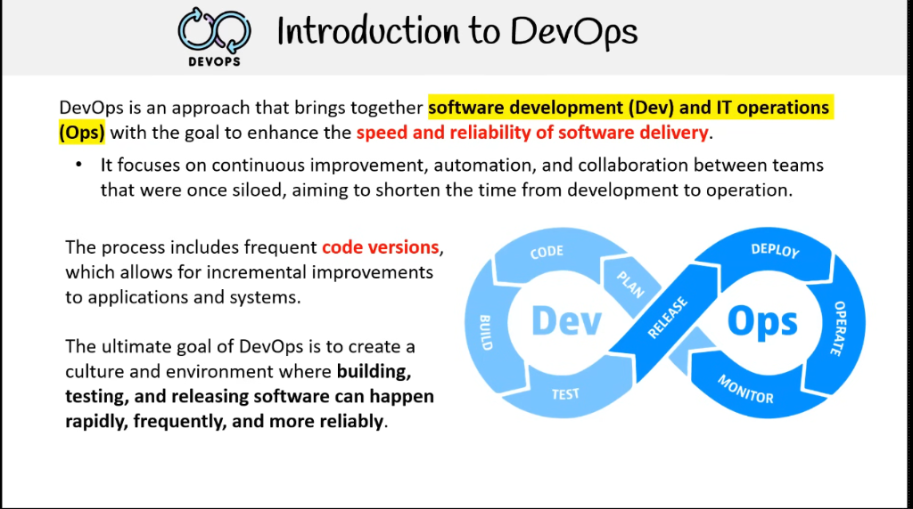

##### 3. Expert-Level Deep Dive & Practical Notes

- **The Canonical Microsoft Definition (Donovan Brown)**:
  > *"DevOps is the union of **people**, **process**, and **products** to enable continuous delivery of **value** to our end users."*

- **The Infinity Loop Stages Breakdown**:
  | Stage | Objective | Microsoft DevOps Tooling |
  | :--- | :--- | :--- |
  | **Plan** | Define requirements, user stories, backlog items, sprint capacity. | Azure Boards, GitHub Projects |
  | **Code** | Author code, review changes via PRs, version control. | Azure Repos, GitHub |
  | **Build** | Compile source code, run unit tests, package binaries/artifacts. | Azure Pipelines, GitHub Actions |
  | **Test** | Automated integration, UI, regression, and load testing. | Azure Test Plans, Playwright, Selenium |
  | **Release** | Manage stage promotions, approval gates, release triggers. | Azure Pipelines Releases, GitHub Environments |
  | **Deploy** | Target provisioning (IaC) and artifact deployment. | Azure Bicep, ARM, Terraform, Kubernetes/App Services |
  | **Operate** | Manage compute health, configuration, patching, autoscaling. | Azure Virtual Machine Scale Sets, AKS, Container Apps |
  | **Monitor** | Real-time telemetry, log aggregation, alerting, user analytics. | Azure Monitor, Application Insights, Log Analytics |

- **Key Architectural & Cultural Shifts**:
  - **From Monolithic Releases to Micro-batches**: Frequent, small-scope incremental deployments significantly lower blast radius and simplify rollbacks.
  - **Eliminating "Over-the-wall" Handoffs**: Developers share responsibility for production reliability, while Ops teams automate platform self-service for developers.
  - **Continuous Feedback**: Telemetry from the `MONITOR` phase directly informs the `PLAN` phase for next sprint backlog prioritization.

- **DORA Metrics (Industry Standard Performance Benchmark)**:
  1. **Deployment Frequency (DF)**: How often code is deployed to production.
  2. **Lead Time for Changes (LTTC)**: Time from commit to production deployment.
  3. **Change Failure Rate (CFR)**: Percentage of deployments causing production failures.
  4. **Mean Time to Recovery (MTTR)**: Time required to restore service after an incident.

> [!TIP]
> **AZ-400 Exam Tip**: Focus on how telemetry feeds back into planning. A common exam question tests how to complete the feedback loop: monitoring errors in Application Insights automatically creates a Work Item / Bug in Azure Boards for the next sprint.

---

#### Why DevOps? (Key Challenges Addressed)

##### 1. Slide Transcript (As-Is)
> **Introduction to DevOps**
>
> **Why DevOps?**  
> DevOps eliminates the **inefficiencies, miscommunications, and delays** that arise from the traditional gap between development and operations teams. It creates a collaborative culture that accelerates and improves software delivery.
>
> **Key Challenges Addressed by DevOps:**
> 1. **Miscommunication and Collaboration Gaps**: Enhances communication and collaboration, reducing misunderstandings and accelerating the release process.
> 2. **Conflicting Goals**: Aligns the goals of Dev and Ops teams towards quick, reliable, and high-quality software delivery.
> 3. **Manual Processes and Bottlenecks**: Advocates for automation to decrease manual effort, errors, and delays.
> 4. **Streamlined Processes**: Automation leads to fewer errors, shorter deployment times, and improved software quality.

##### 2. Visual Reference
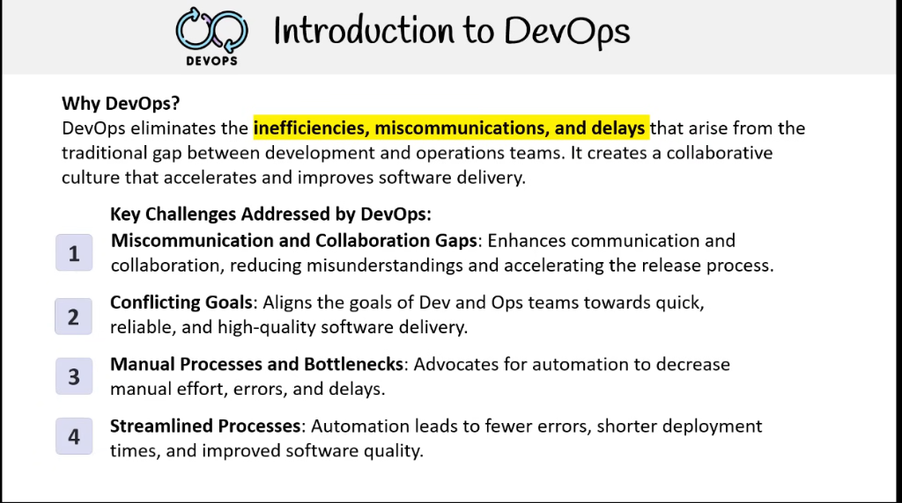

##### 3. Expert-Level Deep Dive & Practical Notes

- **The "Wall of Confusion" Breakdown**:
  - **Traditional Dilemma**:
    - **Developers Incentivized for Change**: Rewarded for shipping new features rapidly.
    - **Operations Incentivized for Stability**: Rewarded for 99.99% uptime and zero outages, creating resistance to frequent releases.
  - **DevOps Alignment**:
    - Both teams share end-to-end KPIs (SLOs, SLIs, Error Budgets, DORA metrics).
    - If error budgets are depleted due to failed deployments, feature releases pause automatically while reliability engineering is prioritized.

- **Eliminating Anti-Patterns through Automation**:
  | Traditional IT Anti-Pattern | Modern DevOps Solution | Azure DevOps / Cloud Implementation |
  | :--- | :--- | :--- |
  | **Manual deployment runbooks ("click-ops")** | Infrastructure as Code & Pipeline Automation | Azure Bicep / Terraform + YAML Multi-stage Pipelines |
  | **Configuration drift between environments** | Immutable infrastructure / Containerization | Azure Container Instances / App Service Deployment Slots |
  | **Long QA cycles at the end of sprints** | Shift-Left Automated Testing | Unit & SonarQube quality gates triggered on Pull Requests |
  | **Siloed tickets and lost requirements** | End-to-End Traceability | Azure Boards linked to Git commits, PRs, and Release stages |

- **Root Causes of Release Delays & Solutions**:
  - **Hand-offs**: Every manual hand-off between Dev $\rightarrow$ QA $\rightarrow$ Security $\rightarrow$ Ops introduces wait time (queue time) that dwarfs actual processing time.
  - **Shift-Left Security & Testing**: Moving linting, SAST (Static Application Security Testing), vulnerability checks, and automated unit tests directly into the PR validation build removes the late-stage security roadblock.

---

#### The Role of a DevOps Engineer

##### 1. Slide Transcript (As-Is)
> **Introduction to DevOps**
>
> **The Role of a DevOps Engineer:**  
> A DevOps engineer facilitates this collaboration and automation, focusing on:
>
> - **Continuous Integration and Continuous Delivery (CI/CD)**: Establishing pipelines that automate code integration, testing, and deployment, ensuring rapid, reliable software releases.
> - **Infrastructure as Code (IaC)**: Managing and provisioning infrastructure through code to increase efficiency and consistency.
> - **Monitoring and Operations**: Implementing monitoring solutions to track application and infrastructure performance, ensuring **high availability and reliability**.
> - **Transition to Cloud Infrastructure**: Many organizations are transitioning to cloud infrastructure (**AWS, Google Cloud, Azure**) to **cut costs** and improve **manageability**, offering intuitive tools for network and security settings but necessitating knowledge of platform-specific features.

##### 2. Visual Reference
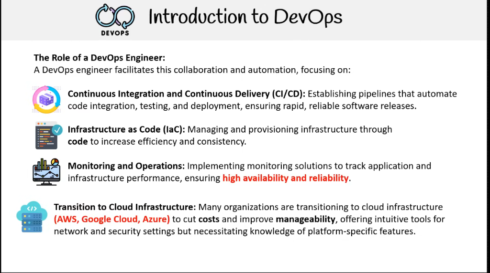

##### 3. Expert-Level Deep Dive & Practical Notes

- **Core Responsibilities Matrix for an Azure DevOps Engineer (AZ-400 Focus)**:
  ```mermaid
  mindmap
    root((Azure DevOps Engineer))
      CI/CD Pipelines
        YAML Pipelines
        Self-Hosted / Microsoft-Hosted Agents
        Branch Policies & Quality Gates
        Artifact & Package Management
      Infrastructure as Code
        Azure Bicep / ARM Templates
        Terraform
        Immutable Deployments & Drift Detection
      Security & Compliance DevSecOps
        Azure Key Vault Secrets
        Dependency Scanning Dependabot/Snyk
        SonarQube / SAST Analysis
      Observability & Reliability
        Application Insights Telemetry
        Log Analytics & KQL Queries
        SLOs / Alerting & Self-Healing
  ```

- **Technical Competencies for Senior / Principal DevOps Engineers**:
  1. **Pipeline Engineering**:
     - Authoring modular, reusable YAML templates (`templates: [...]`).
     - Implementing deployment gates, manual approvals, and canary/blue-green stages.
  2. **Infrastructure as Code & GitOps**:
     - Declarative definitions using Bicep or Terraform; state storage in Azure Blob Storage with lease locking.
     - Automated validation: `az deployment sub what-if` or `terraform plan` on Pull Requests.
  3. **Multi-Tenant / Multi-Cloud Governance**:
     - Managing cross-cloud authentication via OpenID Connect (OIDC) / Workload Identity federation instead of long-lived secret keys.
     - Role-Based Access Control (Azure RBAC) and Azure Policy enforcement during CI/CD.
  4. **Site Reliability Engineering (SRE) Integration**:
     - Defining Service Level Indicators (SLIs) and Service Level Objectives (SLOs).
     - Designing automated rollbacks using Application Insights failure alerts.

> [!TIP]
> **AZ-400 Key Takeaway**: The modern DevOps engineer does not act as a manual deployer or gatekeeper; rather, they are a **Platform Engineer** who builds self-service automated pipelines, guardrails, and compliance tools for software engineering teams.

---

#### Tools and Technologies in DevOps

##### 1. Slide Transcript (As-Is)
> **Introduction to DevOps**
>
> **Tools and Technologies:**
> - **Version Control (e.g., Git)**: Essential for managing code changes and facilitating team collaboration.
> - **Use Agile and Lean Techniques**: For planning, sprint isolation, and capacity management.
> - **Containerization (e.g., Docker)**: Enables scalable deployments with lightweight containers that are faster and simpler to configure than traditional virtual machines.
> - **Orchestration (e.g., Kubernetes)**: Efficiently manages containerized applications at scale.
> - **CI/CD Tools (e.g., Jenkins, GitLab CI)**: Automate the software delivery process, from code integration to deployment.
> - **IaC Tools (e.g., Terraform, Ansible)**: Automate the provisioning and management of infrastructure.
> - **Monitoring and Logging (e.g., Prometheus)**: Provides insights into application performance and operational health.
> - **Public and Hybrid Clouds** streamline operations, offering scalable infrastructure with **IaaS** for seamless app migration and **PaaS** to enhance productivity through sophisticated tools.

##### 2. Visual Reference
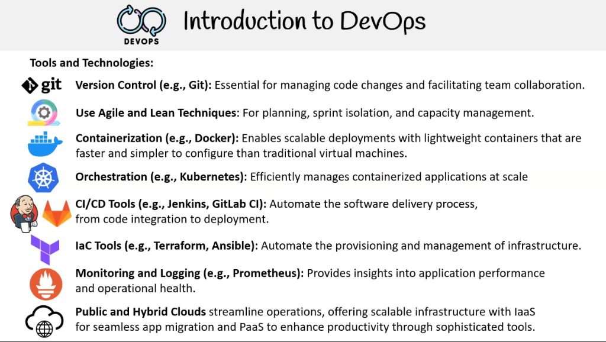

##### 3. Expert-Level Deep Dive & Practical Notes

- **DevOps Toolchain Matrix: Industry Standard vs Microsoft Azure Ecosystem**:
  | Category | Industry / Open Source Tools | Azure DevOps / Microsoft Native Service | AZ-400 Focus & Architecture Role |
  | :--- | :--- | :--- | :--- |
  | **Version Control** | Git, GitLab, Bitbucket | **Azure Repos / GitHub Enterprise** | Distributed VCS, branch policies, PR reviews, secret scanning. |
  | **Planning & Agile** | Jira, Trello, Asana | **Azure Boards / GitHub Projects** | Epics, Features, User Stories, Sprint capacity, Kanban boards. |
  | **Containerization** | Docker Engine, Podman, containerd | **Azure Container Registry (ACR)** | Multi-stage Docker builds, image vulnerability scanning, geo-replication. |
  | **Container Orchestration** | Kubernetes, Nomad | **Azure Kubernetes Service (AKS) / Azure Container Apps (ACA)** | Microservices hosting, auto-scaling (KEDA), ingress routing, service meshes. |
  | **CI/CD Pipelines** | Jenkins, GitLab CI, CircleCI | **Azure Pipelines / GitHub Actions** | Multi-stage YAML workflows, environment approval gates, self-hosted agent pools. |
  | **Infrastructure as Code (IaC)** | Terraform, Ansible, Pulumi | **Azure Bicep / ARM Templates / Terraform** | Declarative state management, idempotent deployments, `what-if` validation. |
  | **Monitoring & Telemetry** | Prometheus, Grafana, Datadog | **Azure Monitor / Log Analytics / App Insights** | Distributed tracing, APM, KQL log queries, automated alert action groups. |
  | **Secret Management** | HashiCorp Vault | **Azure Key Vault** | Hardware Security Modules (HSM), RBAC secret access, pipeline secret injection. |

- **Cloud Delivery Models in DevOps**:
  - **IaaS (Infrastructure as a Service)**: E.g., Azure VMs, Virtual Machine Scale Sets. Full OS-level control; requires custom configuration management (Ansible / DSC / Packer).
  - **PaaS (Platform as a Service)**: E.g., Azure App Service, Azure Functions. Managed runtime; ideal for fast CI/CD deployments with deployment slots and zero OS patching overhead.
  - **CaaS / Serverless Containers**: E.g., Azure Container Instances (ACI), Azure Container Apps (ACA). Rapid scale-to-zero microservices and pipeline build agents without cluster maintenance overhead.

> [!NOTE]
> **AZ-400 Exam Concept - Tool Interoperability**: Microsoft exams frequently test hybrid toolchains (e.g., using **GitHub** for source code, **Azure Pipelines** for CI/CD, **Terraform** for IaC, and **Azure Monitor** for observability). You are expected to design seamless integrations across both open-source and Microsoft-native platforms.

---

#### DevOps Technologies Across Stages (Detailed Mapping)

##### 1. Slide Transcript (As-Is)
> **Introduction to DevOps**
>
> Examples of DevOps technologies across different DevOps stages include:
>
> - **Planning**: **Azure Boards**, **GitHub**, Atlassian Jira
> - **Continuous Integration**: **Azure Repos**, **GitHub Repos**, **SonarQube**, Selenium, **OWASP ZAP**, NuGet, npm
> - **Continuous Delivery**: **Azure Pipelines**, **GitHub Actions**, Bicep, Terraform, Jenkins, RedHat Ansible, Chef, Puppet
> - **Operations**: **Azure Monitor**, **Azure Automation**, Microsoft Power BI
> - **Collaboration and feedback**: **Azure DevOps Wikis**, **GitHub Wikis**, GitHub Discussions, Microsoft Teams, Slack
>
> *(Diagram Elements - Azure DevOps Loop Integrations)*:
> - **PLAN**: Azure Board, Azure LabServices, Microsoft Teams
> - **BUILD / CI**: Azure Repo, Azure Artifacts, CredScan, WhiteSource (Mend) OSS scan, SonarQube, AzSK, Azure Pipeline, Selenium (Se), Azure Test Plan
> - **DEPLOY / CD**: Azure Pipeline, AppCenter, LogicApp
> - **OPERATE & FEEDBACK**: ChatBot, Retros, PowerBI, Azure Monitor

##### 2. Visual Reference
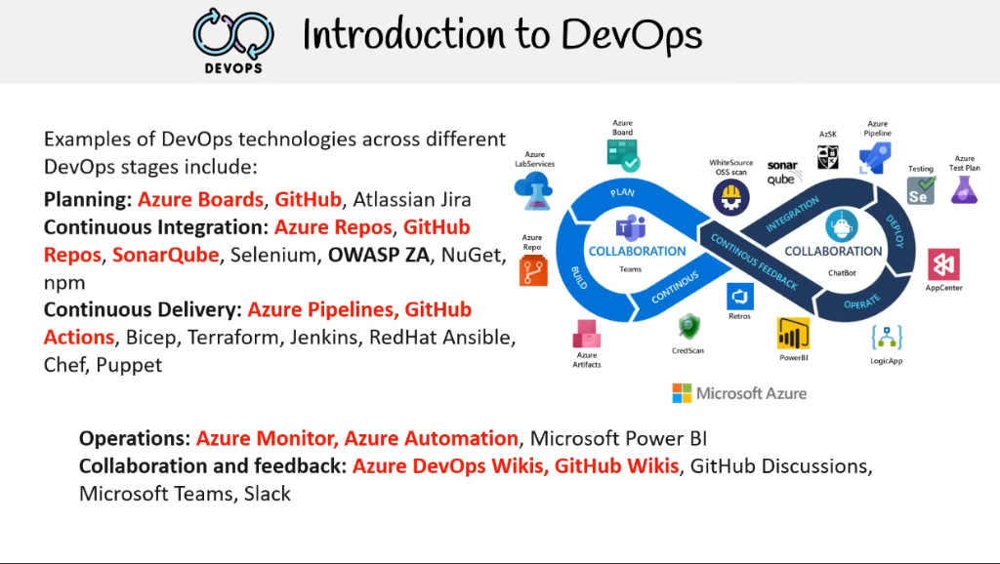

##### 3. Expert-Level Deep Dive & Practical Notes

- **End-to-End Pipeline Integration Architecture**:
  ```mermaid
  flowchart TD
      subgraph Plan ["1. Plan & Track"]
          AB[Azure Boards / GitHub Projects]
          Wiki[Azure DevOps / GitHub Wiki]
      end

      subgraph Build_CI ["2. Source, Build & Shift-Left Security"]
          AR[Azure Repos / GitHub] --> Pipe[Azure Pipelines / GitHub Actions]
          Pipe --> CS[CredScan / Secret Scanning]
          Pipe --> SQ[SonarQube SAST Code Quality]
          Pipe --> WS[Mend / WhiteSource SCA Open Source]
          Pipe --> Art[Azure Artifacts / NuGet / npm]
      end

      subgraph Test_QA ["3. Automated Quality Gates"]
          TP[Azure Test Plans]
          Sel[Selenium / Playwright Automated UI]
          OWASP[OWASP ZAP DAST Security]
      end

      subgraph Deploy_CD ["4. Continuous Delivery & Infrastructure"]
          IaC[Azure Bicep / Terraform]
          ACR[Azure Container Registry]
          Deploy[App Services / AKS / App Center]
      end

      subgraph Ops_Feedback ["5. Operations & Continuous Feedback"]
          AM[Azure Monitor & App Insights]
          PBI[Power BI Analytics & Retros]
          Teams[Microsoft Teams / Slack Notifications]
      end

      Plan --> Build_CI
      Build_CI --> Test_QA
      Test_QA --> Deploy_CD
      Deploy_CD --> Ops_Feedback
      Ops_Feedback -. Telemetry & Work Items .-> Plan
  ```

- **Security & Quality Tool Category Breakdown (AZ-400 Essentials)**:
  1. **Credential & Secret Scanning (CredScan / GitHub Secret Scanning)**:
     - Detects hardcoded connection strings, API keys, certificates, and private tokens *before* merge or build.
  2. **Static Application Security Testing (SAST - SonarQube / GitHub CodeQL)**:
     - Scans uncompiled source code for injection vulnerabilities, SQLi, XSS, and security anti-patterns without executing the code.
  3. **Software Composition Analysis (SCA - Mend / WhiteSource / Dependabot / Snyk)**:
     - Analyzes third-party open-source dependencies and packages (npm, NuGet, Maven) for known CVEs and license compliance.
  4. **Dynamic Application Security Testing (DAST - OWASP ZAP)**:
     - Executes black-box security scanning against a live, running staging environment to find runtime vulnerabilities.
  5. **Functional & Automated UI Testing (Selenium / Playwright / Azure Test Plans)**:
     - Executes automated browser tests and tracks manual test runs, exploratory sessions, and regression suites.

> [!TIP]
> **AZ-400 Exam Scenario**: When designing a secure release pipeline, remember the exact sequence:
> `Secret Scanning (CredScan)` $\rightarrow$ `SAST (SonarQube/CodeQL)` $\rightarrow$ `SCA (Mend/Dependabot)` $\rightarrow$ `Build & Unit Tests` $\rightarrow$ `Artifact Packaging` $\rightarrow$ `Deployment to Staging` $\rightarrow$ `DAST (OWASP ZAP) & UI Tests (Selenium)` $\rightarrow$ `Production Promotion Gate`.

#### DevOps vs Traditional IT

##### 1. Slide Transcripts (As-Is)

###### Part A: Time, Speed, and Data
> **DevOps vs Traditional IT**
>
> **Time:**
> - DevOps teams spend **one-third more time improving systems** to avoid tech issues than **traditional IT**.
> - Less time is needed for administrative tasks because **DevOps uses more automated tools and helpful scripts**.
> - This saved time allows for a **33% increase** in enhancing their tech infrastructure.
> - They also have **15% more time** for learning and training, boosting their skills.
>
> **Speed and data:**
> - DevOps groups are typically **small and adaptable**, driven by creativity and speed.
> - One of the main goal of DevOps is **agility**, aiming for swift completion of tasks.
> - **Traditional IT operations** typically have less feedback data, focusing only on the immediate task.
> - IT operations often have to handle unexpected downstream issues they didn't see coming.
> - Cloud DevOps is more effective in **delivering business applications** due to its quick pace.
> - Traditional IT must strive to keep up with the rapid changes and demands of the business world.

###### Part B: Recuperation and Software Distribution
> **DevOps vs Traditional IT**
>
> **Recuperation and crunch time:**
> - DevOps teams focus on **readiness for failures** and have strategies like **ongoing testing and real-time alerts**.
> - These strategies mean they can **address issues quickly** and keep systems running smoothly.
> - Traditional IT may need more time to recover from setbacks because they might not have these proactive measures in place.
> - Fast recovery in DevOps is often helped using **automated systems and flexible infrastructure setups**.
>
> **Software distribution:**
> - DevOps teams take roughly **37 minutes** to deploy software.
> - Traditional IT operations typically need about **85 minutes** for the same task.
> - This indicates DevOps teams can release software **more than twice as quickly** as traditional IT teams.

###### Part C: Core Strategic Advantages
> **DevOps vs Traditional IT**
>
> | Aspect | DevOps Advantage |
> | :--- | :--- |
> | **Product Reliability** | Reduced likelihood of failure |
> | **Adaptability** | Enhanced flexibility and support |
> | **Market Responsiveness** | Decreased time to market |
> | **Team Productivity** | Greater efficiency in teams |
> | **Vision Clarity** | More defined product vision within teams |

##### 2. Visual References
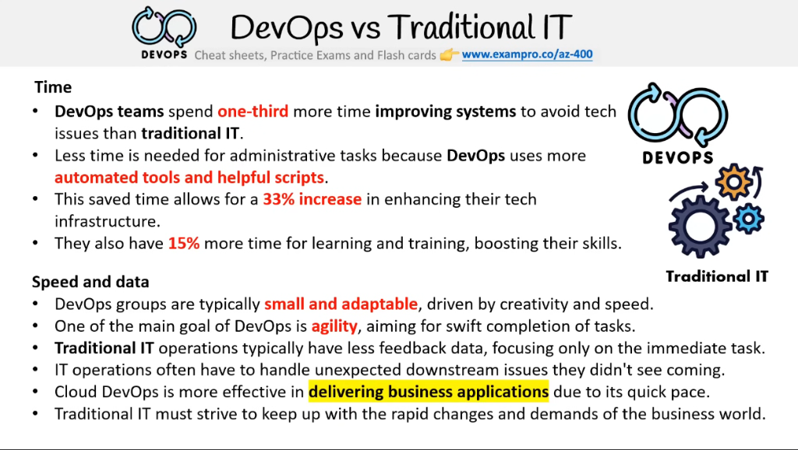

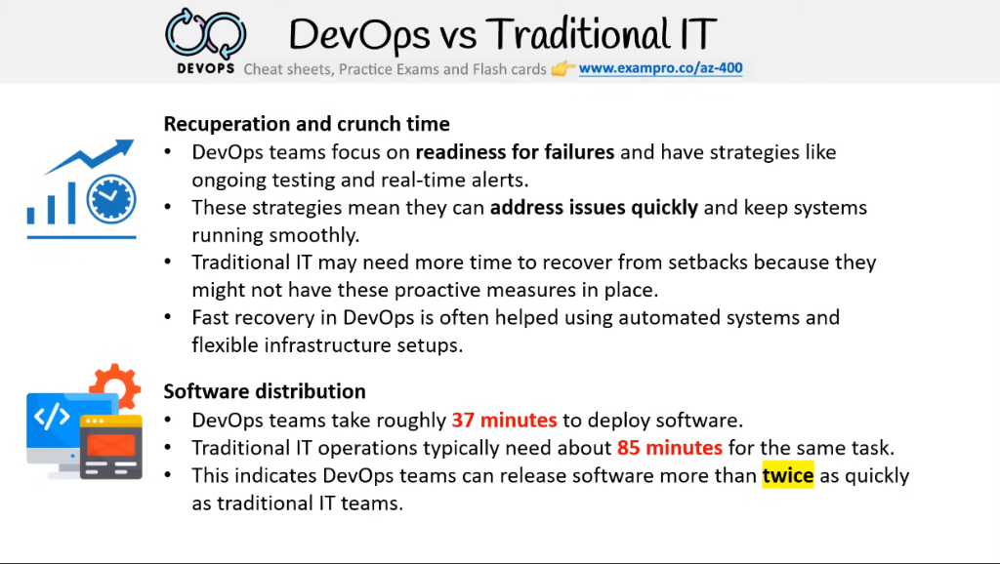

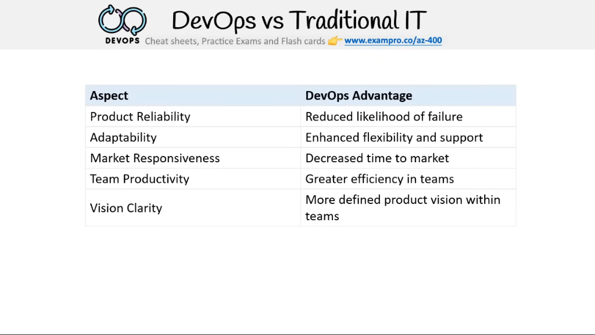

##### 3. Expert-Level Deep Dive & Practical Notes

- **The 5 Business & Engineering Value Drivers (AZ-400 Strategic Focus)**:
  1. **Product Reliability (Reduced Failure Rate)**:
     - **Mechanism**: Shift-Left testing, automated PR static analysis (SonarQube/CodeQL), and automated regression suites prevent defects from reaching production.
     - **Result**: Drastic reduction in Change Failure Rate (CFR) and production outages.
  2. **Adaptability (Enhanced Flexibility & Support)**:
     - **Mechanism**: Decoupled microservices, containerization (Docker/AKS), and modular Infrastructure as Code (Bicep/Terraform).
     - **Result**: Teams can pivot architectures, swap third-party integrations, or spin up transient staging environments on-demand.
  3. **Market Responsiveness (Decreased Time to Market)**:
     - **Mechanism**: Continuous Integration & Continuous Delivery (CI/CD) pipelines coupled with feature flag management (Azure App Configuration).
     - **Result**: Ideas convert to deployable user value in hours/days rather than months/years.
  4. **Team Productivity (Greater Team Efficiency)**:
     - **Mechanism**: Eliminating repetitive administrative toil (SRE 50% rule) via self-service developer platforms, automated CI test parallelism, and automated dependency scanning.
     - **Result**: Developers focus on feature innovation rather than manual release coordination and environment maintenance.
  5. **Vision Clarity (Aligned Product Vision)**:
     - **Mechanism**: Unified backlog management in **Azure Boards / GitHub Projects** where requirements, epics, commits, pull requests, builds, and release deployments are fully linked.
     - **Result**: Complete cross-functional transparency from leadership vision down to individual code commits.

- **Designing for Failure & Fast Recovery (SRE & Resilience Patterns)**:
  - **Readiness for Failure Philosophy**: In modern cloud architecture, failures are treated as inevitable, normal events rather than catastrophic anomalies.
  - **Mean Time to Recovery (MTTR) Optimization**:
    - **Automated Rollback & Swap**: Utilizing Azure App Service deployment slot swaps or Kubernetes blue-green pod routing to revert within seconds if health probes fail.
    - **Self-Healing Infrastructure**: Kubernetes liveness/readiness probes, Azure Virtual Machine Scale Set automatic instance repairs, and Azure Application Gateway automatic health checks.
    - **Failure Injection (Chaos Engineering)**: Using **Azure Chaos Studio** to deliberately inject latency, terminate pods, or simulate network partitions during non-peak hours to validate system resilience.

- **Pipeline & Software Distribution Acceleration Techniques**:
  - **How DevOps Cuts Deployment Time by >50% (37 min vs 85 min)**:
    1. **Pipeline Caching**: Caching npm/NuGet/pip packages across pipeline runs (`Cache@2` task in Azure Pipelines or `actions/cache` in GitHub Actions).
    2. **Multi-Agent Parallelism**: Running unit test slices across multiple pipeline jobs simultaneously.
    3. **Containerized Build Agents**: Eliminating environment spin-up lag by using pre-baked Docker images on Azure Container Instances (ACI).
    4. **Artifact Incremental Releases**: Deploying only delta changes rather than copying complete server disk images.

- **Toil Elimination & SRE Metrics Summary**:
  | Metric / Dimension | Traditional IT | Modern Enterprise DevOps |
  | :--- | :--- | :--- |
  | **Average Deployment Duration** | ~85 minutes (Manual checks & slow rollout) | ~37 minutes (Automated CI/CD pipelines) |
  | **Failure Posture** | Reactive firefighting during crunch time | Proactive resilience, chaos testing & real-time telemetry |
  | **Time Spent Improving Systems** | Baseline (Trapped in operational toil) | **+33% increase** in infrastructure engineering |
  | **Time Allocated for Learning/Upskilling** | Minimal | **+15% more time** dedicated to innovation & training |
  | **Recovery Strategy** | Manual post-mortem & complex rollbacks | Automated health probes, fast rollback & zero-downtime swaps |

> [!TIP]
> **AZ-400 Exam Tip**: When asked how to improve deployment velocity and system recovery, prioritize **automated rollback strategies (Deployment Slot Swaps / Traffic Management)**, **pipeline caching**, and **real-time alerting with Azure Monitor Action Groups** to trigger automated runbooks.

#### Agile Methodology

##### 1. Slide Transcripts (As-Is)

###### Part A: Introduction
> **Azure DevOps Engineer Expert**  
> **Introduction to DevOps**  
> **Agile**

###### Part B: Philosophy & Methodology
> **Agile**
>
> **Agile** is a philosophy in software development that emphasizes **incremental progress, collaboration, and flexibility**. It revolves around the idea of breaking down large projects into smaller, manageable sections called **iterations or sprints**.
>
> Teams work in these short bursts to produce tangible results regularly, allowing for frequent reassessment and adjustment.
> - This approach enables a quick response to change and promotes continuous improvement, both in the product and the process used to create it.
>
> The term **"agile methodology"** refers to the specific frameworks and practices that embody the Agile philosophy, such as **Scrum**, and **Kanban**.
>
> These methodologies provide the structure and tools for teams to execute Agile principles effectively. They include techniques for planning and tracking progress, such as **stand-up meetings**, **sprints**, and **visual boards**, all designed to enhance team coordination and project transparency.
>
> *(Diagram Elements - Agile Cycle)*:
> `Plan` $\rightarrow$ `Design` $\rightarrow$ `[Iterative Core: Develop -> Test -> Deploy -> Review]` $\rightarrow$ `Launch`

###### Part C: Agile Development & Key Success Factors
> **Agile Development**
>
> **Agile Development** encompasses various methods that follow the **Agile Manifesto's** core ideas. It's about teams working together, managing themselves, and using practices that best suit their project's needs to gradually improve their software.
>
> In agile development, teams aim to produce **fully working and high-quality parts** of the software at the end of every sprint.
>
> This means they must **write code, test it, and make sure everything is of good quality** within each sprint's short timeframe.
>
> **The key success factors for Agile development teams:**
> - **Diligent backlog refinement**
> - **Integrating early and often**
> - **Minimizing technical debt**
>
> *(Diagram Elements - Agile Development Loop)*:
> - **Start**: Initiate Project $\rightarrow$ Define Requirements
> - **Cycle**: Development Cycles (Add Functionality) $\rightarrow$ Integrate & Test $\rightarrow$ Review $\rightarrow$ Feedback
> - **Decision Gate**: Approve? (If **YES** $\rightarrow$ Release to Market / If **NO** $\rightarrow$ Record & Incorporate Changes $\rightarrow$ Adjust & Track $\rightarrow$ Next Iteration)
> - **Continuous Visibility**: Clients $\leftrightarrow$ Developers $\leftrightarrow$ Users

###### Part D: Detailed Breakdown of Agile Success Factors
> **Agile Development**
>
> - **Diligent Backlog Refinement**: This means organizing the list of upcoming work, **prioritizing the most important tasks**, and clarifying them. Product owners are key in preparing for future sprints by providing **clear goals**.
> - **Integrating Early and Often**: By using Continuous Integration/Continuous Delivery (CI/CD), teams automate their workflows, which speeds up coding, testing, and deployment. This helps **catch and fix problems early**.
> - **Minimizing Technical Debt**: Just like unwanted financial debt, technical debt happens when taking shortcuts, which may later require code fixes. It's important to find a good mix of **adding new features and fixing these issues**, needing **careful planning and discipline**.
>
> *(Diagram Elements)*:
> - **Backlog Refinement Visual**: Visual Kanban board with prioritized work item cards, swimlanes, and progress tracking.
> - **CI/CD Visual**: Build success/failure metrics bar chart demonstrating frequent build integrations and rapid failure detection.
> - **Technical Debt Visual**: Downward trajectory illustration representing compound drag caused by unaddressed technical shortcuts.

##### 2. Visual References
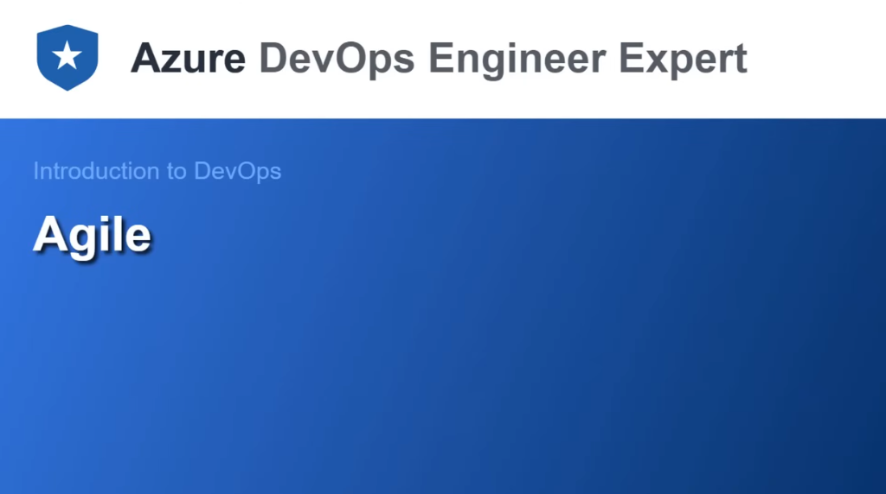

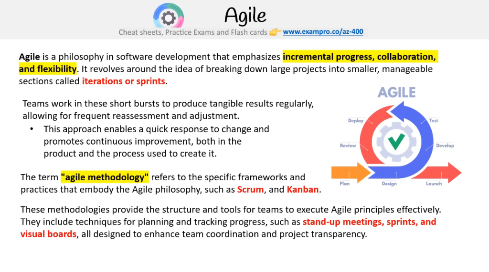

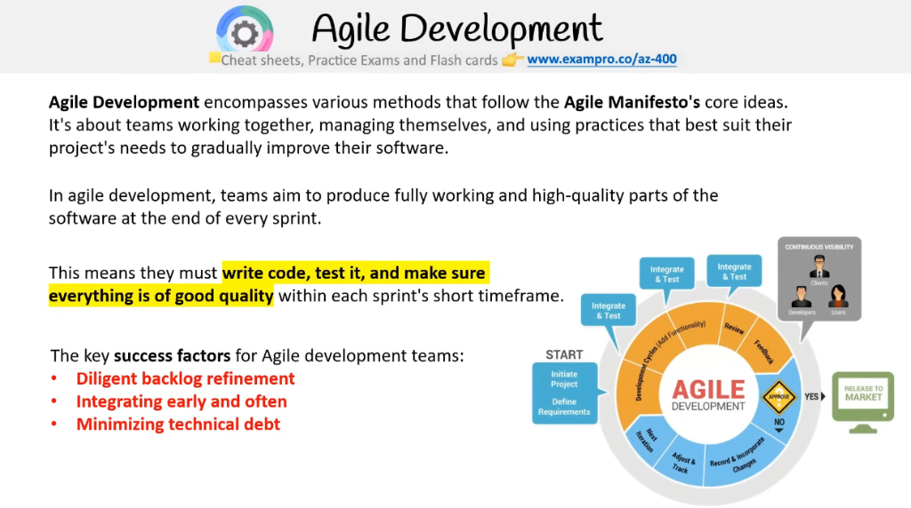

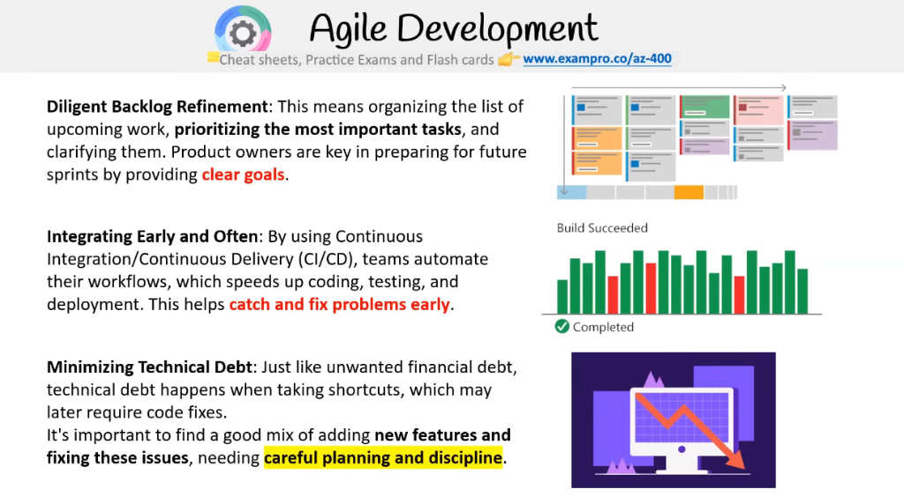

##### 3. Expert-Level Deep Dive & Practical Notes

- **Deconstructing the 3 Agile Success Factors (AZ-400 Engineering Focus)**:
  1. **Diligent Backlog Refinement (Grooming)**:
     - **Mechanism**: Continuous review of the backlog by Product Owners and Engineering Leads to ensure work items meet the **Definition of Ready (DoR)**.
     - **Best Practice in Azure Boards**: Regularly splitting overly large User Stories into smaller PBIs, sizing them with Planning Poker (Story Points), and linking prerequisite dependencies (Parent/Child and Predecessor/Successor links).
     - **Delivery Plans**: Utilizing Azure Boards Delivery Plans to visualize dependencies across multiple cross-functional teams and iterative release milestones.
  2. **Integrating Early and Often (True Continuous Integration)**:
     - **Mechanism**: Developers commit code to shared branches multiple times a day rather than working in long-lived isolated feature branches.
     - **Enabler**: Automated CI validation builds with Pull Request branch policies that compile code, run test suites, and report pass/fail telemetry instantly.
     - **Fast Feedback Loop**: Build breaks turn red immediately; policy prevents merging until broken builds are resolved, preserving main branch stability.
  3. **Managing & Minimizing Technical Debt**:
     - **What is Technical Debt?**: The implied cost of additional future rework caused by choosing an easy/quick solution now instead of using a better approach that takes longer.
     - **DevOps Mitigation Strategy**:
       - **Automated Quality Gates**: Enforcing SonarQube / Azure DevOps Quality Gates to fail builds if code duplication exceeds $3\%$ or new technical debt exceeds a strict threshold (e.g., maintainability rating $< A$).
       - **Explicit Backlog Allocation**: Reserving $15\text{--}20\%$ of every sprint's capacity exclusively for refactoring, dependency upgrades, and technical debt retirement.
       - **Debt Tracking in Azure Boards**: Tagging work items with `TechnicalDebt` to track velocity impact and debt remediation trends over time.

- **The Agile Delivery Model: Core Principles & Execution**:
  - **Incremental & Iterative Delivery**: Rather than attempting comprehensive upfront system architecture (BDUF - Big Design Up Front), teams build vertical slices of working functionality that provide immediate value.
  - **Timeboxed Iterations (Sprints)**: Fixed-duration cycles (typically 1 to 4 weeks, with 2 weeks being the enterprise standard) where scope is locked to prevent scope creep during execution.
  - **Empirical Process Control**: Built on three pillars: **Transparency** (visible boards/backlogs), **Inspection** (daily standups, sprint reviews), and **Adaptation** (retrospectives).

- **The Agile Ceremony Framework in Modern Engineering**:
  | Ceremony | Purpose | Cadence | Azure DevOps Implementation |
  | :--- | :--- | :--- | :--- |
  | **Sprint Planning** | Select PBIs/User Stories for the sprint based on team capacity. | Day 1 of Sprint | Azure Boards Sprint Backlog + Capacity Planning tool |
  | **Daily Stand-up** | 15-min sync: What did I do? What will I do? What is blocking me? | Daily | Azure Boards Taskboard / Delivery Plans |
  | **Sprint Review / Demo** | Demonstrate working, tested software increments to stakeholders. | Final day of Sprint | Live environment demo / Deployment summary |
  | **Sprint Retrospective** | Inspect team process, tooling, and communication; identify 1-2 improvements. | Final day of Sprint | Azure DevOps Retrospectives Extension |

- **How Agile Connects to DevOps (The Natural Evolution)**:
  - **Agile**: Focuses on the *front half* of the value stream—collaborative requirements gathering, user stories, timeboxed sprints, and continuous feedback between Product Owners and Developers.
  - **DevOps**: Extends Agile all the way through the *entire value stream*—automating testing, infrastructure provisioning, progressive delivery, and production observability.
  ```mermaid
  graph LR
      subgraph Agile_Domain ["Agile Domain (Ideation to Code)"]
          PO[Product Owner] --> Stories[User Stories / Backlog]
          Stories --> Sprints[Sprint Planning]
          Sprints --> Dev[Iterative Development]
      end

      subgraph DevOps_Domain ["DevOps Extension (Code to Production Value)"]
          Dev --> CI[Continuous Integration]
          CI --> CD[Continuous Delivery]
          CD --> Monitor[Continuous Monitoring]
          Monitor --> PO
      end
  ```

- **Agile Hierarchy in Azure Boards**:
  - **Epics**: Large initiatives spanning multiple quarters/releases (e.g., "Migrate to Microservices").
  - **Features**: Deliverable functionality within an Epic (e.g., "User Authentication Service").
  - **User Stories / Product Backlog Items (PBIs)**: Deliverable units of value written from user perspective: *"As a `<role>`, I want `<capability>` so that `<business benefit>`."*
  - **Tasks**: Granular technical execution items assigned to individual developers (estimated in hours/points).
  - **Bugs**: Defects linked directly to user stories or test cases.

- **Definition of Ready (DoR) vs Definition of Done (DoD)**:
  - **Definition of Ready (DoR)**: Criteria a work item must satisfy before entering a sprint (clear acceptance criteria, estimated story points, dependencies identified).
  - **Definition of Done (DoD)**: Criteria code must satisfy before marking complete (code reviewed, PR merged, unit tests passing with $>80\%$ coverage, static security scans clean, deployed to staging).

> [!TIP]
> **AZ-400 Exam Tip**: Agile methodologies enable rapid development, but without DevOps automation (CI/CD, automated testing), Agile teams encounter a release bottleneck. DevOps is the operational engine that allows Agile teams to ship software repeatedly and reliably.

#### Scrum and Kanban

##### 1. Slide Transcripts (As-Is)

###### Part A: Introduction
> **Azure DevOps Engineer Expert**  
> **Introduction to DevOps**  
> **Scrum and Kanban**

###### Part B: Scrum Framework, Roles & Lifecycle
> **Scrum**
>
> **Scrum** is an Agile framework designed for managing complex projects by breaking them down into **small, manageable tasks** completed in short phases called **sprints**.
>
> **Key roles in Scrum:**
> - **Product Owner**: Guides what and why the team builds, prioritizes the **work backlog**.
> - **Scrum Master**: Facilitates Scrum processes, supports team improvement, and removes obstacles.
> - **Development Team**: Engineers the product, ensuring its quality.
>
> In Scrum, a team self-manages its sprint tasks with **daily stand-up meetings** to ensure progress and address impediments. They track work using a **task board** and a **sprint burndown chart**, and at the sprint's end, they showcase their increment in a **review and identify improvements** in a **retrospective**.
>
> Scrum's short, repeatable cycles facilitate continuous learning and adaptation, making it a practical framework for teams adopting Agile principles.
>
> *(Diagram Elements - Scrum Lifecycle)*:
> `Product Backlog` $\rightarrow$ `Sprint Planning` $\rightarrow$ `Sprint Backlog` $\rightarrow$ `Sprint Execution (with Daily Scrum Loop)` $\rightarrow$ `Sprint Review` $\rightarrow$ `Potentially Shippable Increment`  
> *(Feedback Loop)*: `Sprint Review` $\rightarrow$ `Sprint Retrospective` $\rightarrow$ `Next Sprint Planning`

###### Part C: Kanban Methodology & Cumulative Flow Diagrams (CFD)
> **Kanban**
>
> **Kanban** is an Agile methodology focused on **visualizing work**, **limiting work in progress**, and **maximizing efficiency** (or flow).
>
> **Kanban boards** are used to display work at **various stages of the process using cards** to represents tasks and their stages, highlighting work in progress and facilitating team flexibility.
>
> **Cumulative Flow Diagrams (CFDs)** visually **track a project's workflow over time**, showing task distribution across stages. The **horizontal axis represents time**, and the **vertical axis represents task volume**, with each color marking a different work stage.
> - **CFDs highlight trends, progress, and bottlenecks**. Parallel colored areas indicate balanced workflow; bulges suggest **bottlenecks** needing attention for smooth project continuation.
>
> *(Diagram Elements - Cumulative Flow Diagram)*:
> - **X-Axis**: Time (Jan 10 $\rightarrow$ Feb 9)
> - **Y-Axis**: Cumulative Task Volume (60 $\rightarrow$ 120 items)
> - **Visual Callout**: Expanding band / bulge indicated as *"Indication of likely issue / bottleneck"*.

###### Part D: Scrum vs Kanban Comparison & The Scrumban Hybrid
> **Scrum vs Kanban**
>
> **Scrum and Kanban in Agile development**  
> While broadly fitting under the umbrella of Agile development, Scrum and Kanban are quite different.
> - **Scrum focuses on fixed length sprints**, while **Kanban is a continuous flow model**.
> - **Scrum has defined roles**, while **Kanban doesn't define any team roles**.
> - **Scrum uses velocity** as a key metric, while **Kanban uses cycle time**.
>
> > Teams often blend Scrum and Kanban features to optimize their workflow. They continuously refine their approach to find the best fit, focusing on simplicity and regular value delivery to users.

##### 2. Visual References
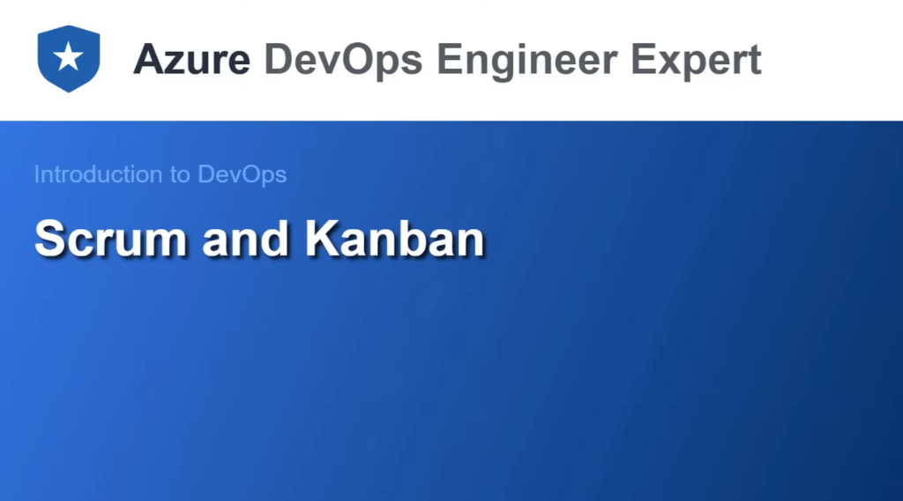

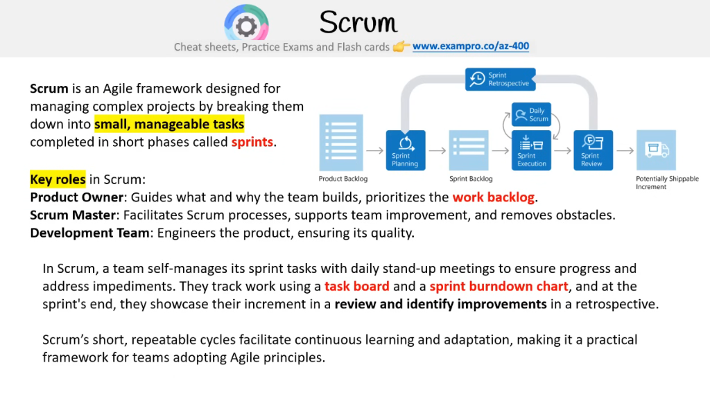

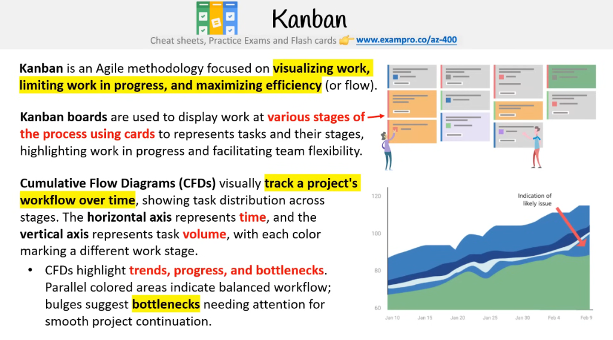

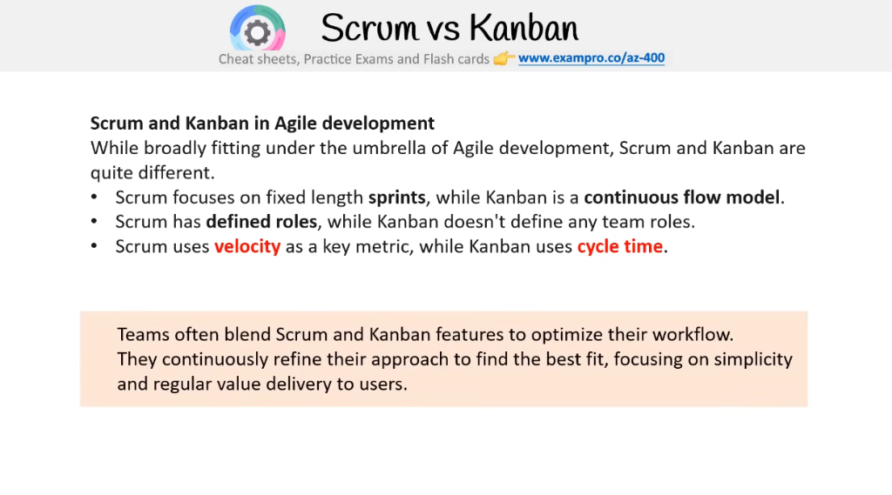

##### 3. Expert-Level Deep Dive & Practical Notes

- **The Scrumban Hybrid Model in Enterprise DevOps**:
  - **What is Scrumban?**: A hybrid agile methodology combining Scrum's structure (sprint planning, retrospectives, demos) with Kanban's process improvement mechanisms (visual boards, pull systems, WIP limits).
  - **Why Engineering Teams Adopt Scrumban**:
    - Pure Scrum often struggles with unexpected high-priority production defects (interrupts break sprint commitments).
    - Pure Kanban lacks the structured cadences that executive stakeholders often require for strategic roadmap forecasting.
  - **Scrumban Implementation in Azure Boards**:
    - Sprints are configured to organize release cycles and retrospectives.
    - The Board is configured with **column WIP limits** and **swimlanes (Expedite for Sev-1 bugs)** so work is pulled based on capacity rather than rigidly pushed into developers' queues.

- **Architectural Comparison: Scrum vs Kanban**:
  | Dimension | Scrum | Kanban | Scrumban Hybrid |
  | :--- | :--- | :--- | :--- |
  | **Delivery Cadence** | Fixed timeboxed sprints (1-4 weeks). | Continuous delivery / pull-based flow. | Fixed sprint cadence with continuous pull execution. |
  | **Workflow Engine** | Batch-push into Sprint Backlog. | Continuous pull based on WIP limits. | Pull system constrained by sprint goals and WIP limits. |
  | **Role Requirements** | Strict (PO, Scrum Master, Dev Team). | None prescribed (flexible/self-organizing). | Flexible; often retains Product Owner and Agile Coach. |
  | **Primary Metric** | Velocity (Story Points / Sprint). | Cycle Time & Lead Time (Days/Hours). | Both Velocity and Lead/Cycle Time are tracked. |
  | **Best Fit Use Case** | New product development with stable requirements. | Support, operations, maintenance, infrastructure. | Maturing engineering teams evolving towards full CI/CD. |

- **The Kanban Flow System Architecture**:
  ```mermaid
  flowchart LR
      subgraph Board ["Azure Boards Kanban Configuration"]
          New["1. New Backlog<br/>(Unlimited)"] --> Active["2. In Development<br/>(WIP Limit: 3)"]
          Active --> Test["3. QA & Code Review<br/>(WIP Limit: 2)"]
          Test --> Deploy["4. Staging Deploy<br/>(WIP Limit: 2)"]
          Deploy --> Closed["5. Done / Production<br/>(Closed)"]
      end
      
      classDef warn fill:#ffcccc,stroke:#ff0000,stroke-width:2px;
      Active -. Exceeds Limit -> Alert[Column Turns Red: WIP Violated]
  ```

- **Mathematical Underpinning: Little's Law in DevOps**:
  $$\text{Lead Time} = \frac{\text{Work in Progress (WIP)}}{\text{Throughput}}$$
  - To decrease delivery lead time without burning out engineering capacity, teams **must reduce WIP**.
  - Lower WIP limits force team members to swarm on blocked items rather than starting new uncompleted tasks (*"Stop starting, start finishing"*).

- **Interpreting Cumulative Flow Diagrams (CFDs - AZ-400 Exam Crucial Topic)**:
  | CFD Visual Characteristic | System Diagnosis | Corrective Action |
  | :--- | :--- | :--- |
  | **Parallel Bands (Uniform Width)** | Balanced, stable workflow. Throughput matches arrival rate. | Maintain current WIP limits and capacity. |
  | **Expanding Band (Bulge)** | **Bottleneck detected** in that specific stage. Tasks are accumulating faster than downstream can process. | Reallocate engineers to swarm the bottleneck stage; lower upstream WIP limits. |
  | **Contracting Band (Narrowing)** | Downstream stage is starved for work because upstream is blocked. | Investigate upstream blockage or feed more prioritized backlog items. |
  | **Flat Upper Line (Plateau)** | Arrival rate has halted (no new work entering system). | Check backlog refinement or project initiation. |
  | **Flat Lower Line (Stagnation)** | Zero items being closed/delivered (deployment/release blocker). | Investigate CI/CD pipeline outages or environment blocking issues. |
  | **Horizontal Distance between lines** | Represents **Lead Time / Cycle Time**. | Shorter distance = faster delivery to market. |
  | **Vertical Distance between lines** | Represents **Work in Progress (WIP)** volume. | Narrower height = lower inventory risk and less multitasking. |

- **Azure Boards Kanban Advanced Features**:
  - **Column WIP Limits**: Set minimum/maximum item thresholds per column. Azure Boards turns the column header red when exceeded.
  - **Split Columns (Doing / Done)**: Sub-divides a state (e.g., Development $\rightarrow$ `Doing` vs `Done`) to track wait states before handoff.
  - **Swimlanes**: Horizontal rows separating work types (e.g., an **Expedite / P1 Urgent Bug** swimlane that bypasses normal queue order).
  - **Definition of Done (DoD) per Column**: Hoverable tooltip checklists reminding developers of mandatory criteria before moving a card right.

- **The 3-5-3 Scrum Architecture (AZ-400 Mastery)**:
  ```mermaid
  flowchart TD
      subgraph Roles ["3 Core Roles"]
          PO[Product Owner - What & Why]
          SM[Scrum Master - Process & Impediments]
          DT[Dev Team - How & Quality]
      end

      subgraph Artifacts ["3 Core Artifacts"]
          PBL[Product Backlog] --> SBL[Sprint Backlog]
          SBL --> INC[Potentially Shippable Increment]
      end

      subgraph Ceremonies ["5 Core Events / Ceremonies"]
          SP[1. Sprint Planning]
          DS[2. Daily Scrum / Stand-up]
          Sprint[3. The Sprint Execution]
          SR[4. Sprint Review / Demo]
          Retro[5. Sprint Retrospective]
      end
  ```

- **Scrum Artifacts & Azure Boards Implementation**:
  1. **Product Backlog**: Prioritized list of all features, bugs, and technical requirements. Managed via Azure Boards **Backlogs** view with stack ranking.
  2. **Sprint Backlog**: Subset of PBIs committed for the current sprint broken down into granular child Tasks. Managed via Azure Boards **Sprints / Taskboard**.
  3. **Increment**: The sum of all completed backlog items meeting the team's **Definition of Done (DoD)**, ready for automated release pipeline trigger.

- **Sprint Metrics & Burndown Analytics**:
  - **Sprint Burndown Chart**: Displays remaining effort (in hours or story points) over the sprint timeline.
    - *Ideal Trend Line*: Uniform downward slope to zero by sprint end.
    - *Upward Spike*: Scope added mid-sprint (scope creep).
    - *Flat Line followed by drop*: Batched task closures or blocked work.
  - **Velocity Chart**: Measures story points completed per sprint over time, used to forecast team capacity for future sprint planning.

- **Core Philosophical Differences**:
  - **Scrum**: Focuses on **timeboxing (sprints)**, predefined roles, committed scope, and regular delivery increments.
  - **Kanban**: Focuses on **continuous flow**, visualizing work, minimizing cycle time, and strictly enforcing **Work in Progress (WIP) limits**.

- **Architectural Comparison: Scrum vs Kanban**:
  | Dimension | Scrum | Kanban |
  | :--- | :--- | :--- |
  | **Cadence / Delivery** | Fixed timeboxed sprints (1-4 weeks). | Continuous delivery / pull-based flow as items finish. |
  | **Change Management** | Scope locked during the sprint; changes deferred to next backlog grooming. | Changes can be made anytime by pulling the highest priority item from backlog. |
  | **Work in Progress (WIP)** | Regulated via Sprint Velocity & team capacity estimation. | Explicit **WIP limits per column** on the visual board. |
  | **Key Roles** | Product Owner, Scrum Master, Development Team. | No prescribed roles (team-driven self-organization). |
  | **Key Metrics** | Sprint Velocity, Sprint Burndown, Burnup Charts. | Lead Time, Cycle Time, Cumulative Flow Diagram (CFD). |
  | **Estimation** | Story Points (Fibonacci), Planning Poker, Effort hours. | Optional / Minimal (focus is on item throughput and cycle time). |

- **Azure DevOps Process Model Alignment (AZ-400 Core Knowledge)**:
  - **Basic Process**: Lightweight (Issue $\rightarrow$ Task).
  - **Agile Process**: User Stories, Features, Epics, Tasks, Bugs. Tracks Story Points and Original/Remaining Work.
  - **Scrum Process**: Product Backlog Items (PBIs), Bugs, Tasks, Epics, Features. Tracks Effort and Remaining Work.
  - **CMMI Process**: Requirements, Change Requests, Risks, Reviews, Tasks, Bugs. Strict formal auditing and governance.

> [!TIP]
> **AZ-400 Exam Tip**: If an exam question describes a team handling **interrupt-driven work** (e.g., production support, infrastructure operations, hotfixes), **Kanban** is the recommended methodology. If the team is developing **planned feature increments with cross-functional commitments**, **Scrum** is the recommended choice.

#### Flow Metrics

##### 1. Slide Transcripts (As-Is)

###### Part A: Introduction
> **Azure DevOps Engineer Expert**  
> **Introduction to DevOps**  
> **Flow Metrics**

###### Part B: Velocity in Azure DevOps
> **Velocity**
>
> **Velocity** in Azure DevOps is a metric that tracks the **amount of work a team completes during a sprint**, helping teams estimate how much work they can handle in future sprints.
>
> It's represented in a chart that visualizes **work items completed over several sprints**, offering insights into the team's work patterns, efficiency, and consistency.
>
> By analyzing velocity, teams can adjust their planning for better **predictability and productivity**.
>
> Consistent velocity metrics can help in identifying the impact of **process changes and guiding strategic decisions** to enhance overall team performance.
>
> *(Diagram Elements - Azure Boards Velocity Analytics)*:
> - **Team**: `Fabrikam Fiber Team`
> - **Configuration**: Velocity by `Count of Work Items` (or Story Points / Effort), configured for `Last 6 iterations`.
> - **Calculated Output**: Average Velocity (e.g., `92`).
> - **Bar Components**: `Planned` (light blue), `Completed` (dark green), `Completed Late` (light green), `Incomplete` (blue).

###### Part C: Sprint Burndown in Azure DevOps
> **Sprint burndown**
>
> **Sprint burndown chart:**  
> The **sprint burndown** is a graph that plots the **daily total of remaining work**, typically shown in **hours**.
>
> The burndown chart provides a visual way of showing whether the team is **on track to complete all the work by the end of the sprint**.
>
> It also helps in identifying any **bottlenecks or issues in the workflow** that may need attention before the sprint's end.
>
> *(Diagram Elements - Azure Boards Burndown Trend Analytics)*:
> - **Configuration**: Start Date (`3/1/2019`) $\rightarrow$ End Date (`3/31/2019`), Burndown on `Count of Work Items` / `Remaining Work (Hours)`.
> - **Metrics**: Completed (`99%`), Average Burndown (`4`), Stories Remaining (`1`), Total Scope Increase (`+6`).
> - **Visual Elements**:
>   - Blue Area: **Remaining Work**.
>   - Orange Line: **Total Scope** (tracks mid-sprint additions/creep).
>   - Grey Diagonal: **Ideal Trend Line**.
>   - Grey Vertical Shading: **Non-working days** (weekends/team holidays).

###### Part D: Lead Time and Cycle Time in Azure DevOps
> **Lead time and Cycle time**
>
> The **Lead Time** and **Cycle Time** widgets indicate how long it takes for work to flow through your development pipeline.
> - **Lead time** measures the **total time elapsed from the creation of work items to their completion**.
> - **Cycle time** measures the **time it takes for your team to complete work items once they begin actively working on them**.
>
> The diagram illustrates how lead time differs from cycle time across **State Categories**:
> - **Lead time** is calculated from **work item creation** to entering a **Completed** state.
> - **Cycle time** is calculated from **first entering an In Progress or Resolved state category** to entering a **Completed** state category.
>
> **State Categories across Process Templates:**
> | Process Model | Proposed State (Lead Time only) | In Progress / Resolved State (Cycle Time active) | Completed State (End) |
> | :--- | :--- | :--- | :--- |
> | **Agile** | `New` | `Active` $\rightarrow$ `Resolved` | `Closed` |
> | **Scrum** | `New` $\rightarrow$ `Approved` | `Committed` | `Done` |
> | **CMMI** | `Proposed` | `Active` $\rightarrow$ `Resolved` | `Closed` |
>
> > *Key Takeaway*: These measures help teams plan, spot variations in efficiency, and identify potential process issues. The **lower** the lead and cycle times, the **faster the throughput** your team has.

##### 2. Visual References
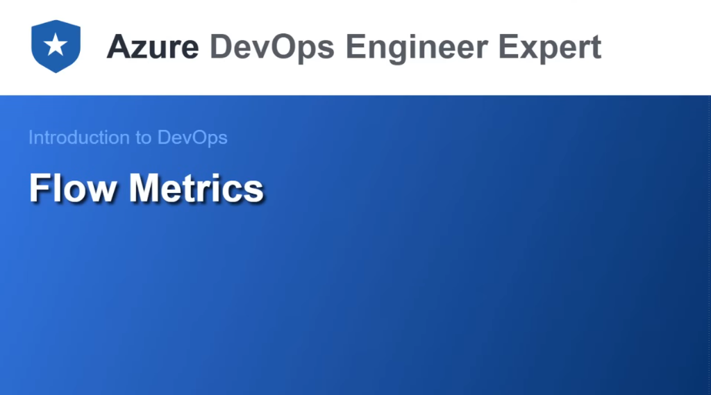

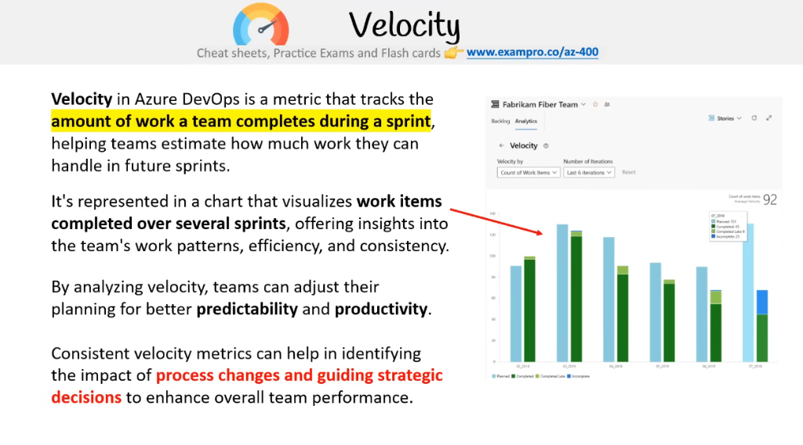

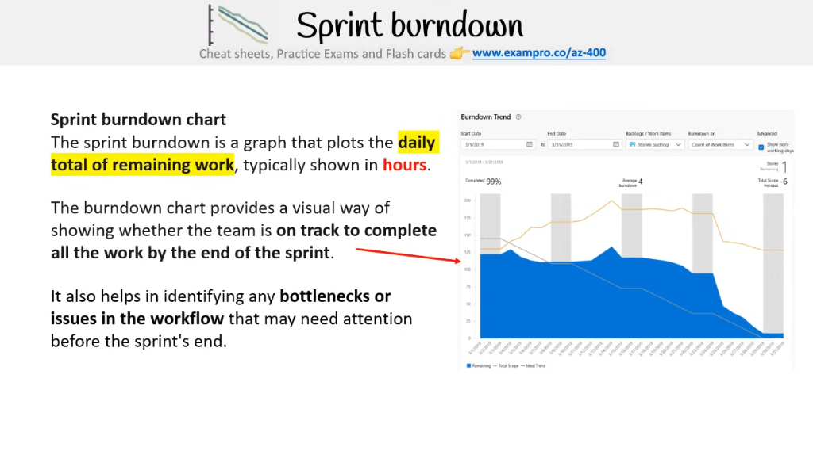

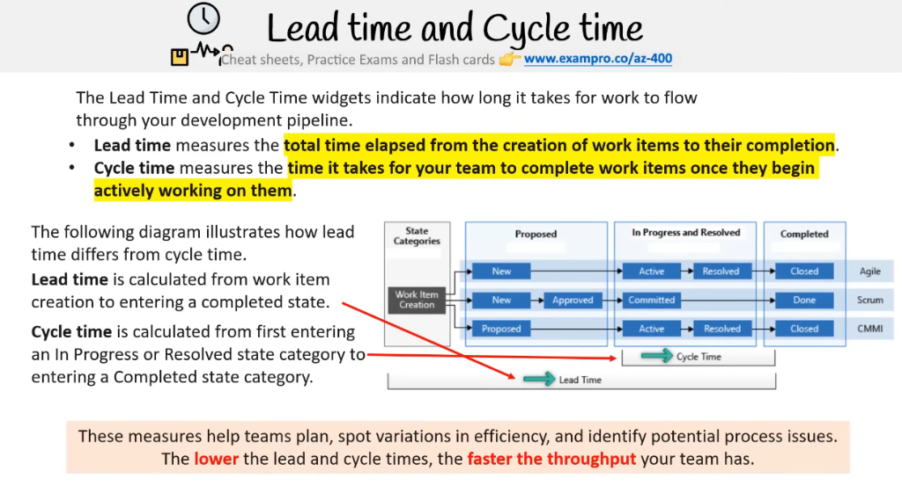

##### 3. Expert-Level Deep Dive & Practical Notes

- **Azure DevOps State Category Architecture**:
  - Every work item state (e.g., `New`, `Active`, `In Review`, `Closed`) maps internally to one of four immutable **State Categories**:
    1. **Proposed**: Work is logged, queued, or being refined (Contributes to Lead Time; **does NOT** contribute to Cycle Time).
    2. **InProgress**: Active engineering or testing is underway (Initiates Cycle Time).
    3. **Resolved**: Code is tested/staged and awaiting final production signoff or automated verification.
    4. **Completed**: Work is deployed to production and closed (Terminates both Lead Time and Cycle Time).
    5. **Removed**: Discarded from the backlog (Excluded from Lead/Cycle time metrics).

- **Lead Time vs Cycle Time Mathematical Formulas**:
  $$\text{Lead Time} = T_{\text{Completed}} - T_{\text{Created}}$$
  $$\text{Cycle Time} = T_{\text{Completed}} - T_{\text{First Entered InProgress/Resolved}}$$
  $$\text{Backlog Queue Wait Time} = \text{Lead Time} - \text{Cycle Time}$$

- **Azure Boards Lead & Cycle Time Control Charts (Percentiles & Control Limits)**:
  - Azure Boards plots individual work items as scatter points along with **50th, 70th, 80th, and 95th percentiles**.
  - **Service Level Expectation (SLE)**: High-maturity teams use the 85th percentile Cycle Time (e.g., "85% of our stories are delivered within 4 days") to provide reliable commitments to business stakeholders rather than guessing with average estimates.

- **Burndown Chart Diagnostic Matrix (AZ-400 Pattern Recognition)**:
  | Visual Curve Pattern | Root Cause Diagnosis | Enterprise Engineering Remedy |
  | :--- | :--- | :--- |
  | **Actual line tracking below ideal slope** | Team is ahead of schedule / under-committed during sprint planning. | Pull next prioritized user story from the top of the Product Backlog into the sprint. |
  | **Actual line tracking above ideal slope** | Team is behind schedule / over-committed. | Negotiate with Product Owner to move lower-priority PBIs out of the active sprint. |
  | **Sudden upward spike in Total Scope line** | **Scope Creep**: New work items or bugs added mid-sprint. | Enforce strict sprint backlog change policies; require PO approval and trade-offs. |
  | **Horizontal plateau followed by steep cliff** | **"Water-Scrum-Fall" / Batch Testing**: Developers only close tasks on the final 2 days of the sprint. | Shift-Left automated testing; enforce smaller user stories and daily PR merging. |
  | **Zero movement across multiple days** | Team blocked by environment outage, third-party dependency, or missing spec. | Escalate blockers during Daily Scrum; Scrum Master actively resolves impediments. |

- **Burnup vs Burndown (Key Exam Distinction)**:
  - **Burndown Chart**: Focuses on **Remaining Work** decaying to zero. Ideal for daily sprint-level tracking by engineering teams.
  - **Burnup Chart**: Focuses on **Total Completed Work vs Total Scope Line**. Superior for long-term multi-sprint releases because it explicitly separates *scope increases* from *slow team progress*.

- **Azure Boards Working Days Configuration**:
  - Located under **Project Settings $\rightarrow$ Team Configuration $\rightarrow$ Working Days**.
  - Excludes Saturdays, Sundays, and corporate holidays from the ideal trend line slope calculations, ensuring accurate daily burndown trajectories.

- **Azure Boards Velocity Chart Anatomy (AZ-400 Analytics)**:
  | Bar Component | Meaning & Operational Context | Pipeline / Board Impact |
  | :--- | :--- | :--- |
  | **Planned Work** | Total work items or story points assigned to the sprint at the end of Day 1 (Sprint Planning). | Establishes the baseline commitment for the sprint. |
  | **Completed** | Work completed on or before the sprint end date that satisfied the Definition of Done (DoD). | Counts towards official sprint velocity. |
  | **Completed Late** | Work finished after the official sprint end date. | Highlighted to identify timeline estimation slips or delayed deployment validation. |
  | **Incomplete** | Unfinished work remaining when the sprint was closed. | Automatically prompted by Azure Boards to move to the next sprint or return to the backlog. |

- **How Velocity Drives Capacity Forecasting**:
  $$\text{Forecasted Sprints to Release} = \frac{\text{Remaining Product Backlog Points}}{\text{Rolling Average Velocity (Last 3-6 Sprints)}}$$
  - Using a rolling average (typically 3 to 6 iterations) smooths out anomalies caused by team vacations, holidays, or onboarding.

- **Enterprise Governance & Velocity Pitfalls (Crucial SRE / Engineering Culture)**:
  - **Goodhart's Law Warning**: *"When a measure becomes a target, it ceases to be a good measure."*
  - **Do NOT compare velocity across different teams**: Team A sizing in Story Points with an average velocity of 50 is not "faster" or "more productive" than Team B with an average velocity of 25. Story point estimation is strictly relative and internal to each individual team's sizing scale.
  - **Use Velocity for Forecasting Only**: Use velocity solely for capacity planning and detecting internal team disruption (e.g., a sudden 50% velocity drop indicates technical blockers, onboarding friction, or unmanaged technical debt).

- **The 5 Core Flow Framework Metrics**:
  ```mermaid
  mindmap
    root((Flow Metrics))
      Flow Velocity
        Number of PBIs/Features completed over time
        Measures throughput
      Flow Time
        Lead Time creation to delivery
        Cycle Time active work to delivery
      Flow Efficiency
        Active Work Time vs Total Lead Time
        Identifies waste and queue waiting
      Flow Load
        Total Work in Progress WIP
        Surfaces over-utilization
      Flow Distribution
        Ratio of Features vs Defects vs Tech Debt vs Risks
  ```

- **Lead Time vs Cycle Time (Crucial AZ-400 Concept)**:
  - **Lead Time**: The total elapsed time from when a work item is **first created/logged** (e.g., ticket created in Azure Boards) until it is **delivered into production**.
    $$\text{Lead Time} = \text{Queue Wait Time} + \text{Active Cycle Time}$$
  - **Cycle Time**: The elapsed time from when work **actively begins** on the item (e.g., state changed from `New` $\rightarrow$ `Active` or branch created) until it is **delivered/closed**.
    $$\text{Cycle Time} = \text{Active Work Time} + \text{In-Process Wait Time}$$

- **Flow Efficiency Formula & Analysis**:
  $$\text{Flow Efficiency} = \left( \frac{\text{Active Development Time}}{\text{Total Lead Time}} \right) \times 100\%$$
  - In traditional waterfall/siloed IT, flow efficiency is often **$< 10\%$** (items spend 90%+ of their lifecycle waiting in hand-off queues for CAB approval, testing slots, or deployment windows).
  - High-performing DevOps teams aim for **$> 40\%$** flow efficiency by automating quality gates and eliminating manual approval handoffs.

- **Flow Distribution (Balancing Value Types)**:
  - Tracks the allocation of engineering capacity across four fundamental item types:
    1. **Features (Business Value)**: New capabilities for end users.
    2. **Defects (Quality Value)**: Fixing functional bugs and broken experiences.
    3. **Technical Debt (Architecture Value)**: Upgrading libraries, refactoring code, improving pipeline speed.
    4. **Risks (Governance & Security Value)**: Remediating CVEs, security patching, compliance controls.

> [!TIP]
> **AZ-400 Exam Tip**: If a team's **Lead Time** is high while their **Cycle Time** is low, the delay is occurring in the **backlog queue before active work starts** (e.g., slow triage or prioritization). If both Lead Time and Cycle Time are high, the bottleneck is in the **development/testing/deployment pipeline itself**.

#### Azure Boards Overview

##### 1. Slide Transcripts (As-Is)

###### Part A: Introduction
> **Azure DevOps Engineer Expert**  
> **Introduction to DevOps**  
> **Azure Boards**

###### Part B: Key Hubs in Azure Boards
> **Azure Boards**
>
> **Azure Boards** is a **web-based service designed for planning, tracking, and discussing work** throughout the development process, supporting agile methodologies for a customizable and efficient workflow.
>
> **Key Hubs in Azure Boards:**  
> Azure Boards includes several key hubs, each serving distinct project management needs:
> - **Work Items Hub**: Manage **work items** based on specific criteria.
> - **Boards Hub**: Visualize workflow using cards, ideal for **Kanban**.
> - **Backlogs Hub**: Plan and organize work items, including **backlogs** for project and portfolio management.
> - **Sprints Hub**: Handle **sprint-specific work items**, incorporating **Scrum** practices.
> - **Queries Hub**: Generate **custom** work item lists and perform **bulk updates**.
> - **Delivery Plans Hub**: Track **cross-team deliverables** and dependencies in a calendar view.
> - **Analytics Views Hub**: Create **Power BI** reports for detailed project analysis.
>
> *(Diagram Elements - Azure DevOps UI Navigation Sidebar)*:
> Shows navigation pointers to: `Work items`, `Boards`, `Backlogs`, `Sprints`, `Queries`, `Delivery Plans`, `Analytics views`.

###### Part C: Key Benefits & GitHub Integration
> **Azure Boards**
>
> **Key benefits of Azure Boards include:**
> - **Scalable Simplicity**: Easy to start with predefined work item types, scalable for growing teams.
> - **Visual Tools**: Visualize progress with **Kanban boards, scrum boards, and delivery plans**.
> - **Customization**: Configure **boards, taskboards, and plans**, including **custom fields**.
> - **Built-in Communication**: Capture **real-time communication and decisions** within work item forms.
> - **Cloud Storage**: Support for rich text, inline images, attachments, and comprehensive change history.
> - **Efficient Search and Notifications**: Tools for quick work item searching and customizable **alerts**.
> - **Dashboards and Analytics**: Access to **dashboards and Analytics** service for reporting.
>
> **Integration and Support:**
> - **GitHub and Office Integration**: Connects with **GitHub repositories** and supports import/export with **Microsoft Office (Excel)**.
> - **Autonomous Teams Support**: Tailors to independent teams, integrates with **Microsoft Teams and Slack**, and offers a variety of marketplace extensions.
>
> *(Diagram Elements - Azure DevOps UI Settings)*:
> Shows `Project Settings` $\rightarrow$ `Boards` $\rightarrow$ `GitHub connections` with options to link GitHub accounts via OAuth, PAT, or GitHub Enterprise Server.

##### 2. Visual References
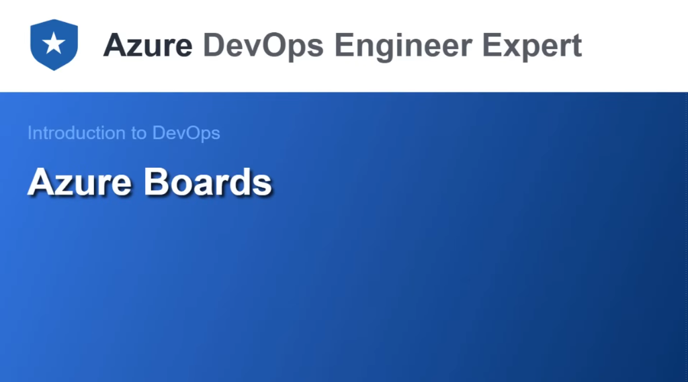

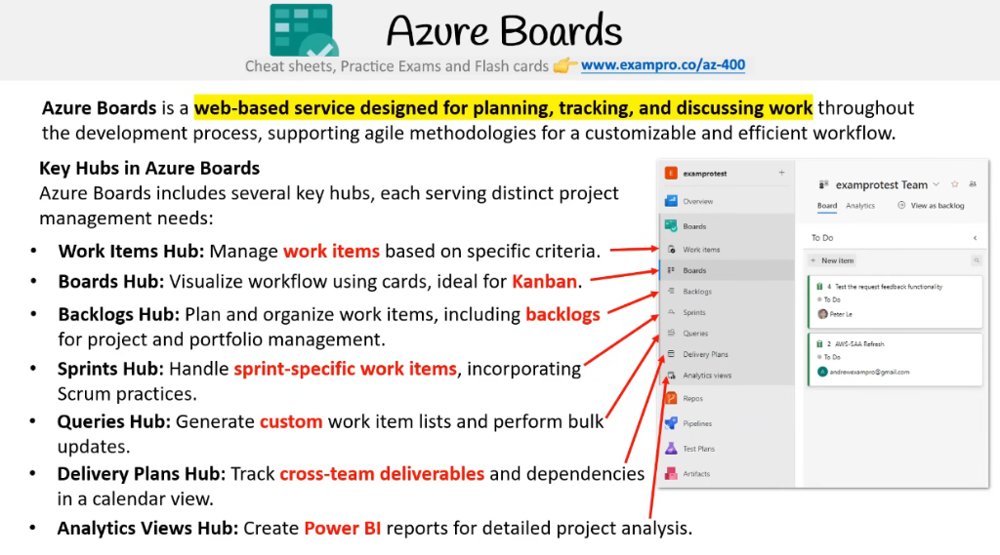

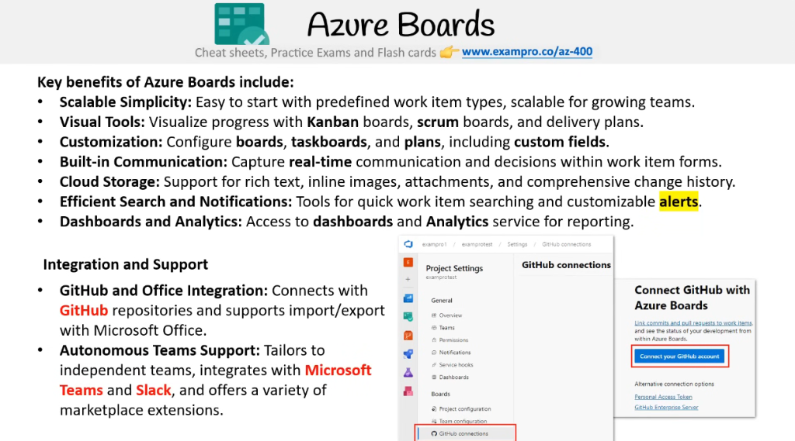

##### 3. Expert-Level Deep Dive & Practical Notes

- **GitHub + Azure Boards Enterprise Integration Architecture**:
  ```mermaid
  flowchart LR
      subgraph GitHub ["GitHub Platform"]
          Repo[GitHub Repository]
          PR[Pull Request 'AB#101']
          Commit[Commit 'AB#101']
      end

      subgraph AzureBoards ["Azure Boards"]
          App[Azure Boards GitHub App]
          WI[Work Item #101]
          Status[State: Active -> Closed]
      end

      Repo -->|Webhook Event| App
      Commit -->|Links Commit| WI
      PR -->|Merge Event| Status
      App -->|Updates Development Widget| WI
  ```

- **Integration Methods & Protocols (AZ-400 Key Scenarios)**:
  1. **Azure Boards App for GitHub (Recommended)**:
     - Installed from the GitHub Marketplace.
     - Uses fine-grained GitHub App permissions rather than personal user accounts.
     - Supports linking multiple GitHub repositories to a single Azure DevOps project.
  2. **Personal Access Token (PAT) / OAuth**:
     - Used when integrating Azure Boards with on-premises **GitHub Enterprise Server**.
  3. **Microsoft Excel Integration**:
     - Using the *Azure DevOps Office Integration* add-in to perform mass imports, structural hierarchy restructuring, and offline bulk edits in Excel with two-way sync (`Publish` / `Refresh`).

- **Inherited Process Customization (Enterprise Governance)**:
  - System processes (Agile, Scrum, Basic, CMMI) are locked and immutable.
  - To customize: Create an **Inherited Process** (e.g., `MyCompany-Agile`).
  - Allows adding custom work item types (e.g., `SecurityRisk`), custom fields (e.g., `CostCenter`, `TargetReleaseDate`), conditional rules (e.g., *Make 'Root Cause' mandatory when Bug state changes to Resolved*), and custom picklist values.

- **Detailed Technical Breakdown of the 7 Key Hubs**:
  1. **Work Items Hub**:
     - Quick filter lists: *Assigned to me*, *Following*, *Mentioned*, and *My activity*.
     - Full history audit logging: Every field change, state transition, and discussion comment is timestamped with identity.
  2. **Boards Hub (Kanban)**:
     - Real-time drag-and-drop workflow visualization.
     - Supports live column WIP limits, split Doing/Done columns, card customization (styling rules, custom fields), and automated card reordering.
  3. **Backlogs Hub (Portfolio & Product Backlog)**:
     - Hierarchical parent-child tree view (Epics $\rightarrow$ Features $\rightarrow$ Stories).
     - Drag-and-drop stack ranking (priority order).
     - Multi-team backlog scoping using Area Paths.
  4. **Sprints Hub (Taskboard & Capacity Planning)**:
     - Daily execution interface during active iterations.
     - **Capacity Planning**: Configure per-developer daily working hours and activity types (Development, Testing, Documentation) to prevent overallocation.
  5. **Queries Hub (Work Item Query Language - WIQL)**:
     - SQL-like filtering across any field (e.g., `SELECT [System.Id] WHERE [System.AssignedTo] = @Me AND [System.State] = 'Active'`).
     - **Bulk Updates**: Select 100+ items simultaneously to change state, iteration, area path, or tags in a single batch operation.
     - Query Chart Widgets: Convert query results into pie charts, bar charts, and pivot tables pinned directly to team dashboards.
  6. **Delivery Plans Hub**:
     - Interactive multi-team Gantt/calendar timeline.
     - Directly visualizes cross-team dependencies (colored dependency link lines turn red if a prerequisite task finishes after the dependent task starts).
  7. **Analytics Views Hub (Power BI Integration)**:
     - Exposes curated OData endpoints for Azure DevOps data without impacting operational transactional database performance.
     - Directly consumed in Power BI Desktop / Service to generate executive portfolio dashboards, defect density reports, and long-term trend analysis.

- **What is Azure Boards?**:
  - Azure Boards is an enterprise-grade Agile project management service built into Azure DevOps that enables teams to plan, track, and discuss work across the entire software development lifecycle.

- **The Five Core Hubs of Azure Boards**:
  ```mermaid
  mindmap
    root((Azure Boards Hubs))
      Work Items
        Individual units of work
        Customizable fields, tags & attachments
      Boards
        Visual Kanban boards
        Column WIP limits, swimlanes, DoD
      Backlogs
        Hierarchical backlog views
        Stack-ranking, capacity planning & forecasting
      Sprints Taskboard
        Sprint execution & capacity tracking
        Daily task management & burndown charts
      Queries
        Work Item Query Language WIQL
        Custom filtering, chart generation & alert emails
      Delivery Plans
        Multi-team milestone synchronization
        Cross-project timeline dependency tracking
  ```

- **Enterprise Project Hierarchy & Scalability**:
  - **Azure DevOps Organization**: The top-level administrative boundary (e.g., `dev.azure.com/{Organization}`).
  - **Projects**: Security and resource boundaries housing Repos, Boards, Pipelines, Artifacts, and Test Plans.
  - **Teams**: Sub-project organizational units. A single project can contain dozens of autonomous teams, each with their own dedicated Backlogs, Kanban Boards, Sprint Iterations, and Area Paths.
  - **Area Paths & Iteration Paths**:
    - **Area Paths (`Project\TeamA\SubArea`)**: Categorizes work items by functional feature ownership or microservice architecture.
    - **Iteration Paths (`Project\Sprint 1\Week 1`)**: Establishes timeboxed execution cadences.

- **End-to-End Traceability Matrix**:
  | Action in Azure Boards | Linked DevOps Artifact | Automation Trigger / Benefit |
  | :--- | :--- | :--- |
  | **Create Branch from Work Item** | Azure Repos / GitHub Branch | Names branch `users/name/workitem-123`; creates two-way lineage link automatically. |
  | **Mention Work Item in Commit** | Git Commit message (`AB#123`) | Associates commit, displays diff inside Azure Boards work item history. |
  | **Link Pull Request** | Pull Request (`AB#123` or PR link) | Automatically transitions work item state from `Active` $\rightarrow$ `Resolved` on PR merge. |
  | **Pipeline Run Association** | CI/CD YAML Build & Release | Displays deployment status (e.g., *Deployed to Staging / Production*) directly on the work item card. |

> [!TIP]
> **AZ-400 Exam Tip**: To link a GitHub commit or pull request to an Azure Boards work item automatically, prefix the commit message or PR description with the syntax **`AB#<WorkItemID>`** (e.g., `git commit -m "Fix login validation bug AB#4521"`).

#### Traceability

##### 1. Slide Transcripts (As-Is)

###### Part A: Introduction
> **Azure DevOps Engineer Expert**  
> **Introduction to DevOps**  
> **Traceability**

###### Part B: Requirements Management & Version Control
> **Traceability**
>
> **Traceability** allows tracking **connections and dependencies** among different parts of a software system. It helps teams grasp the effects of **changes, handle risks, and comply with regulations**.
>
> **Defining and managing requirements:**  
> A key part of traceability is **documenting and overseeing requirements** effectively. Azure DevOps has tools like **Azure Boards** for handling requirements and tracking their progress, linking requirements to related items like **tasks or bugs**.
> - This tracking clarifies each requirement's progress and its influence on the project.
>
> **Version control and change management:**  
> For traceability, a solid version control system to monitor modifications to code and files is essential. **Azure DevOps's Git repositories** let developers manage their work efficiently.
> - By using branches for features or releases, you can track changes and understand their role in the project's bigger picture.

###### Part C: Building, Testing, and Auditing Traceability
> **Traceability**
>
> **Building and release management:**  
> Traceability must include build and release processes. **Azure Pipelines** facilitates building, testing, and deploying apps, linking build artifacts and code changes to specific tasks, showing what changes made it into each build.
>
> **Test management and quality assurance:**  
> For software quality, traceability is crucial. Tools like **Azure Test Plans** support detailed test management. Linking test cases to requirements or user stories shows how well the testing process covers the initial needs, ensuring thorough validation.
>
> **Auditing and compliance:**  
> Traceability also supports meeting standards and regulations. **Azure DevOps's auditing features** track and log changes, providing details on who changed what and when, supporting accountability and regulatory compliance.

##### 2. Visual References
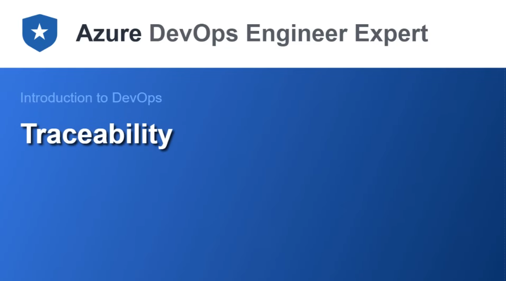

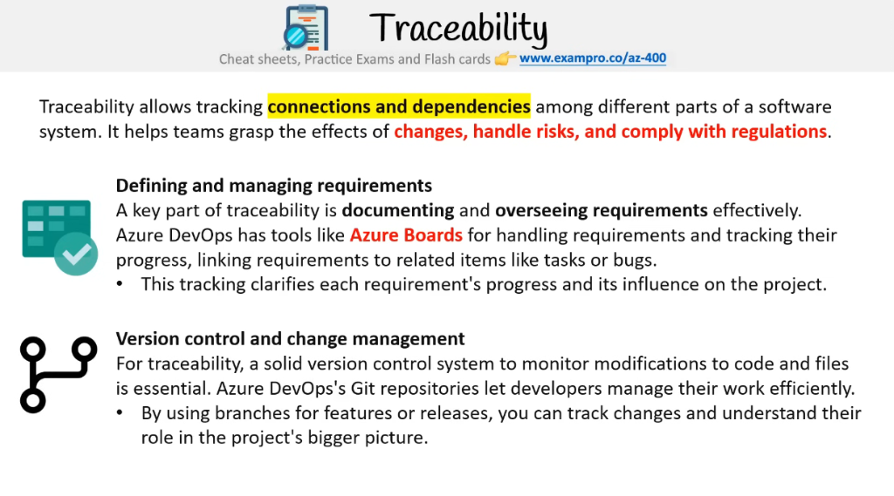

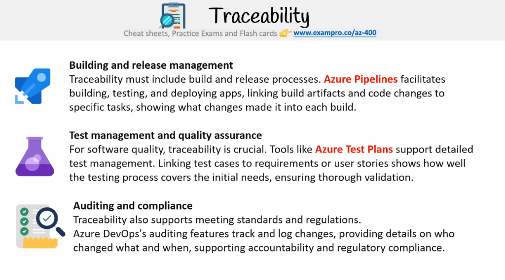

##### 3. Expert-Level Deep Dive & Practical Notes

- **Azure DevOps Auditing & Compliance Streams (AZ-400 Enterprise Architecture)**:
  - **Audit Logging Scope**: Azure DevOps logs every organizational event (e.g., permission modifications, PAT creation, project deletion, service connection updates, IP address, user identity, timestamp).
  - **Exporting Audit Streams (Log Analytics & SIEM)**:
    - In **Organization Settings $\rightarrow$ Auditing $\rightarrow$ Streams**, DevOps engineers can stream audit events to:
      1. **Azure Log Analytics Workspace**: Enables custom KQL queries to detect anomalous administrative actions.
      2. **Azure Event Hubs**: Enables streaming to external SIEMs (Splunk, Datadog).
      3. **Azure Storage Account / Microsoft Sentinel**: Long-term immutable retention for regulatory compliance audits (SOX, HIPAA, FedRAMP).

- **Requirements Traceability Matrix (RTM) in Azure Test Plans**:
  - Automatically correlates every acceptance criterion in a User Story to its corresponding manual test scripts or automated unit/integration tests.
  - **Pipeline Test Analytics**: When pipelines run automated tests (`PublishTestResults@2` task), failure diagnostics and flakiness trends link directly to the commit SHA and work item.

- **Build Artifact Lineage & Provenance**:
  - In modern secure pipelines, every artifact output (drop) contains metadata linking:
    - The exact Git commit SHA that generated the binary.
    - The pipeline build run ID and parameters.
    - The Software Bill of Materials (SBOM) listing all third-party package dependencies.
    - Environment deployment approval logs (which engineers approved promotion to production).

- **Requirements-to-Code Traceability Architecture**:
  ```mermaid
  flowchart TD
      subgraph Requirements ["Requirements Layer (Azure Boards)"]
          Epic[Epic / Strategic Goal] --> Feature[Feature]
          Feature --> Story[User Story #205]
          Story --> Bug[Linked Bug #310]
      end

      subgraph VersionControl ["Version Control Layer (Azure Repos / GitHub)"]
          Story -->|Creates Linked Branch| Branch["git branch: feature/205-auth"]
          Branch --> Commit1["Commit 1: 'Add login schema AB#205'"]
          Branch --> Commit2["Commit 2: 'Add unit tests AB#205'"]
          Commit1 & Commit2 --> PR["Pull Request #42 (Linked to #205)"]
      end

      subgraph Pipeline ["Delivery & Verification Layer"]
          PR -->|Triggers PR Build| CI[Automated CI Validation]
          PR -->|Merge to Main| CD[Deploy to Production]
          CD --> Tag["Git Release Tag: v1.2.0"]
      end
  ```

- **Technical Implementation of Traceability Links in Azure DevOps**:
  1. **Direct Work Item Creation of Branches**:
     - Developers navigate to the User Story in Azure Boards $\rightarrow$ select **"Create a branch"** in the *Development* widget.
     - Automatically creates a bidirectional pointer between the Git branch and the work item.
  2. **Automated Commit Linking (`AB#ID` Syntax)**:
     - Embedding `AB#<ID>` in commit messages automatically attaches the commit SHA, author, and diff directly into the work item's development history pane.
  3. **Pull Request Work Item Linking & Auto-Completion**:
     - When authoring a PR, linking work items allows selecting **"Complete associated work items after merging"**.
     - Automatically shifts linked User Stories from `Active` to `Closed` upon PR approval and merge.

- **Impact Analysis & Risk Handling**:
  - Before modifying a shared microservice, engineers inspect the work item link graph (Parent/Child, Related, Predecessor/Successor) to assess blast radius across dependent squads.
  - Test suites in **Azure Test Plans** are linked directly to User Stories, ensuring every acceptance criterion has a dedicated automated or manual test case validation.

- **What is End-to-End Traceability?**:
  - In enterprise DevOps, **Traceability** is the ability to track the complete lifecycle of a software change across every phase: from initial business requirement/bug $\rightarrow$ source code commit $\rightarrow$ pull request review $\rightarrow$ continuous integration build $\rightarrow$ test execution results $\rightarrow$ release deployment $\rightarrow$ production runtime monitoring.

- **The Complete Traceability Chain (AZ-400 Core Architecture)**:
  ```mermaid
  flowchart LR
      Req["1. Azure Board<br/>User Story #401"] --> Branch["2. Feature Branch<br/>feat/login-auth"]
      Branch --> Commit["3. Git Commit<br/>'AB#401 sha:a7b8c9'"]
      Commit --> PR["4. Pull Request #88<br/>Approved by Reviewer"]
      PR --> CI["5. CI Build #1024<br/>Unit Tests & SonarQube"]
      CI --> Art["6. Azure Artifacts<br/>v1.4.0 (SBOM / Provenance)"]
      Art --> CD["7. Release Pipeline<br/>Prod Deployment Slot"]
      CD --> Telemetry["8. App Insights<br/>Operation ID Telemetry"]
      Telemetry -. Exception / Bug .-> Req
  ```

- **Forward vs Backward Traceability**:
  - **Forward Traceability (Impact Analysis)**:
    - *Scenario*: A Product Owner modifies User Story `#401`.
    - *Question*: Which microservices, test cases, and deployment environments are impacted?
    - *Answer*: Traced through linked Git branches, PRs, and deployment stages.
  - **Backward Traceability (Root Cause Analysis & Auditing)**:
    - *Scenario*: A production crash occurs at 2:00 AM (logged in Application Insights with `Operation_Id`).
    - *Question*: What exact line of code caused this, who authored it, which PR approved it, and which requirement requested it?
    - *Answer*: Tracing backwards: `Crash Log` $\rightarrow$ `Release Tag` $\rightarrow$ `Build Pipeline` $\rightarrow$ `Commit SHA` $\rightarrow$ `Pull Request` $\rightarrow$ `Azure Boards Work Item`.

- **Regulatory & Enterprise Compliance Drivers**:
  - Auditing frameworks (**SOX, HIPAA, PCI-DSS, ISO 27001, FedRAMP**) mandate provable change management.
  - **Enforcing Traceability with Azure Repos / GitHub Branch Policies**:
    1. **Require linked work items**: PRs cannot be merged unless linked to an active User Story or Bug.
    2. **Require minimum number of reviewers**: Ensures 4-eyes principle (no single engineer can deploy unreviewed code).
    3. **Require passing build validation**: Code must compile and pass automated tests before merge.
    4. **Maintain Build Provenance (SBOM)**: Generating a Software Bill of Materials (SBOM) using `spdx-sbom-generator` to record all upstream dependencies.

> [!TIP]
> **AZ-400 Exam Tip**: To guarantee end-to-end traceability in Azure DevOps, enable the branch policy: **"Check for linked work items"** set to **Required**. This prevents developers from merging PRs that lack an associated Azure Boards work item.

