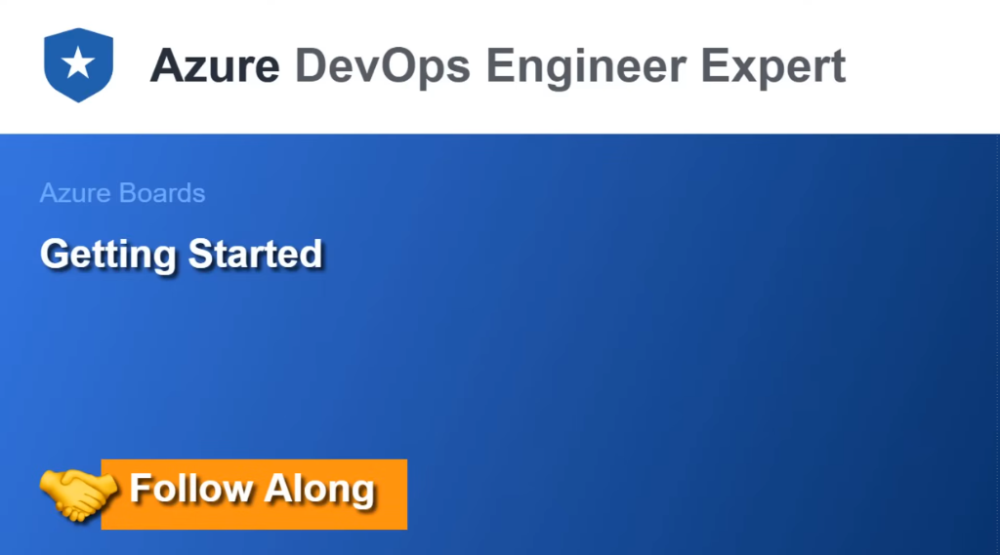
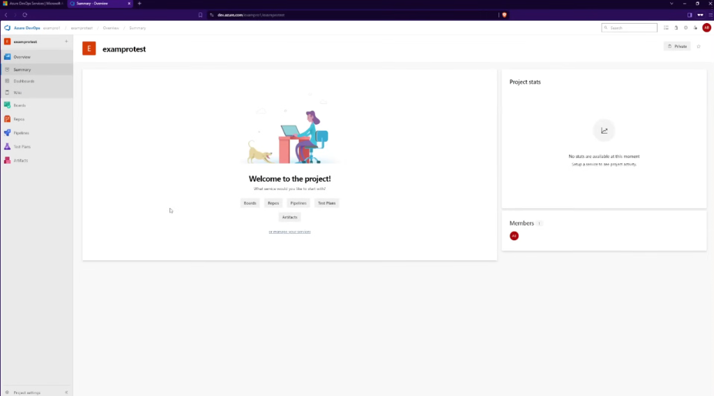
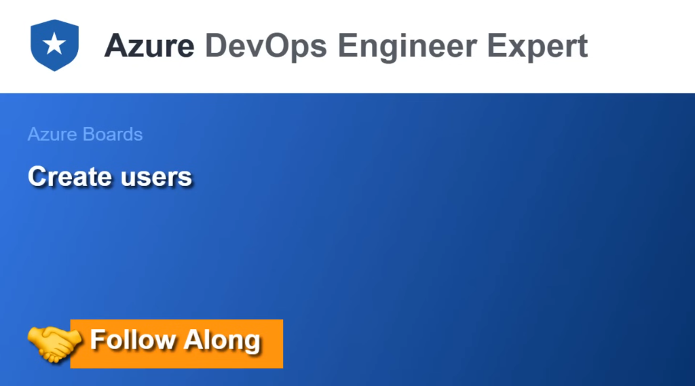
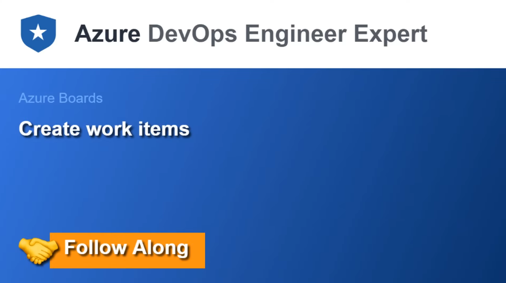
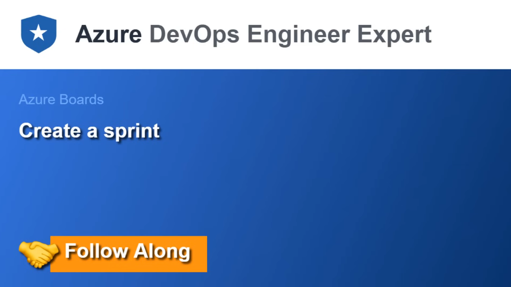

# Module 03: Azure Boards Deep Dive

> **Course:** AZ-400 — Designing and Implementing Microsoft DevOps Solutions  
> **Instructor:** Andrew Brown (ExamPro)  
> ⬅️ [Previous: 02. Introduction to DevOps](02-introduction-to-devops.md) | [Main Index](../README.md) | ➡️ [Next: 04. Collaboration & Communication](04-collaboration-and-communication.md)

---

### 03. Azure Boards Deep Dive

#### Getting Started

##### 1. Slide Transcripts & Walkthrough (As-Is)

###### Part A: Introduction
> **Azure DevOps Engineer Expert**  
> **Azure Boards**  
> **Getting Started** *(Follow Along)*

###### Part B: Project Landing Page & Services Overview
> **Azure DevOps Services Portal**  
> **Organization / Project**: `dev.azure.com/exampro1/examprotest`  
> **Status**: `Private Project`  
>
> **Welcome to the project!**  
> *What service would you like to start with?*  
> - `Boards` | `Repos` | `Pipelines` | `Test Plans` | `Artifacts` | `or manage your services`
>
> **Project stats**: *No stats are available at this moment. Setup a service to see project activity.*  
> **Members**: *1 (Current Project Admin)*  
>
> **Primary Navigation Structure:**
> - **Overview**: Summary, Dashboards, Wiki
> - **Boards**: Work items, Boards, Backlogs, Sprints, Queries, Delivery Plans, Analytics views
> - **Repos**: Files, Commits, Pushes, Branches, Tags, Pull Requests
> - **Pipelines**: Pipelines, Environments, Releases, Library, Task groups, Deployment groups
> - **Test Plans**: Progress report, Runs, Test plans
> - **Artifacts**: Package feeds (NuGet, npm, Maven, PyPI, Universal)
> - **Project settings** (Lower left gear icon)

##### 2. Visual References




##### 3. Expert-Level Deep Dive & Practical Notes

- **End-to-End Enterprise Setup Workflow (Organization to First Project)**:
  ```mermaid
  flowchart TD
      A[1. Sign in to Azure DevOps Portal dev.azure.com] --> B[2. Create Organization e.g. dev.azure.com/my-enterprise]
      B --> C[3. Link Microsoft Entra ID Azure AD Directory]
      C --> D[4. Link Azure Subscription for Billing & Compute]
      D --> E[5. Create New Project e.g. 'examprotest']
      E --> F[6. Configure Process Model Agile/Scrum & Visibility Private]
      F --> G[7. Land on Project Overview & Enable/Disable Services]
      G --> H[8. Assign Access Levels Basic/Stakeholder & Invite Members]
  ```

- **Step-by-Step Implementation Guide**:

  1. **Step 1: Create Organization & Select Hosting Region**:
     - Navigate to `https://aex.dev.azure.com` or `https://dev.azure.com`.
     - Click **+ New organization**.
     - Select the geographical region (e.g., *East US*, *West Europe*) to host organizational metadata, adhering to data residency requirements.

  2. **Step 2: Connect Microsoft Entra ID (Azure AD)**:
     - Under **Organization Settings $\rightarrow$ Microsoft Entra ID**, connect your corporate directory.
     - *Benefit*: Enforces organizational Conditional Access (MFA, IP restrictions), and enables assigning security groups directly to projects.

  3. **Step 3: Create the Project with Strategic Defaults**:
     - Click **+ New project**.
     - **Project Name**: Choose a concise, canonical name (e.g., `examprotest`).
     - **Visibility**: Always choose **`Private`** for enterprise proprietary code.
     - **Advanced Options**:
       - **Version Control**: Select **`Git`** (Distributed VCS).
       - **Work Item Process**: Select **`Agile`** or **`Scrum`** (or your organization's custom inherited process).

  4. **Step 4: Manage Enabled Services (Minimizing Clutter)**:
     - Click the **Project settings** gear icon (bottom-left) $\rightarrow$ **Overview**.
     - Toggle on/off specific modules depending on your stack (e.g., if using GitHub Actions for CI/CD, you can toggle *Pipelines* off; if not using manual testing suites, toggle *Test Plans* off).

  5. **Step 5: Configure Access Levels & Security Groups**:
     - **Access Levels (Organization Settings $\rightarrow$ Users)**:
       - **Basic (First 5 free per org)**: Full access to Azure Boards, Azure Repos, and Azure Pipelines.
       - **Stakeholder (Free unlimited)**: View and edit work items, view boards, submit feedback; no access to code repos or pipeline creation.
       - **Visual Studio Subscriber**: Automatically receives Basic or Basic + Test Plans license based on subscription tier.
     - **Default Security Groups (Project Settings $\rightarrow$ Permissions)**:
       - `Project Administrators`: Full administrative control over repository policies, service connections, and permissions.
       - `Contributors`: Day-to-day engineers (can push to branches, create PRs, update work items).
       - `Readers`: Read-only access to source code and work items.

- **Automation via Azure CLI (`az devops`)**:
  ```bash
  # Log in with Azure credentials
  az login

  # Install Azure DevOps CLI Extension
  az extension add --name azure-devops

  # Create project with all parameters
  az devops project create \
    --name "examprotest" \
    --description "Core platform project" \
    --process "Agile" \
    --source-control "git" \
    --visibility "private" \
    --organization "https://dev.azure.com/exampro1"
  ```

> [!TIP]
> **AZ-400 Exam Tip - Access Levels**: A very common exam question presents a scenario where a non-developer (Product Owner, QA Manager, or Business Analyst) needs to review backlogs, create work items, and track burndown charts without purchasing additional licenses. The correct answer is to assign them the **Stakeholder Access Level**, which is free and unlimited.

- **Azure DevOps Tenancy & Organization Setup**:
  - **URL Structure**: `https://dev.azure.com/{OrganizationName}`.
  - **Identity Foundation**: Backed by **Microsoft Entra ID (Azure AD)** for enterprise Single Sign-On (SSO), Multi-Factor Authentication (MFA), and Conditional Access Policies.

- **Project Provisioning Parameters (AZ-400 Core Knowledge)**:
  ```mermaid
  graph TD
      Org[Azure DevOps Organization] --> Proj[New Project]
      Proj --> Vis[Visibility: Private vs Public]
      Proj --> VC[Version Control: Git vs TFVC]
      Proj --> Process[Process Model: Basic / Agile / Scrum / CMMI]
  ```

  | Parameter | Options | Recommended Enterprise Default | AZ-400 Notes |
  | :--- | :--- | :--- | :--- |
  | **Visibility** | `Private` \| `Public` | **`Private`** | Public projects allow anonymous access; enterprise IP must remain private. |
  | **Version Control** | `Git` \| `TFVC` | **`Git`** | Always select Git for distributed version control. TFVC is centralized legacy. |
  | **Work Item Process** | `Basic` \| `Agile` \| `Scrum` \| `CMMI` | **`Agile` / `Scrum`** | Process model dictates default work item types and state categories. |

- **Automation via Azure DevOps CLI (`az devops`)**:
  ```bash
  # 1. Install the Azure DevOps CLI extension
  az extension add --name azure-devops

  # 2. Configure default organization
  az devops configure --defaults organization=https://dev.azure.com/MyEnterpriseOrg

  # 3. Provision a new project programmatically
  az devops project create \
    --name "ECommerce-Platform" \
    --description "Core cloud microservices platform" \
    --process "Agile" \
    --source-control "git" \
    --visibility "private"
  ```

- **Initial Administrative Checklist After Creation**:
  1. **Disable Unused Services**: Under **Project Settings $\rightarrow$ General $\rightarrow$ Overview**, turn off services not currently required (e.g., disable *Test Plans* or *Artifacts* to simplify sidebar UI).
  2. **Configure Security & Groups**: Add contributors to default security groups (*Project Administrators*, *Contributors*, *Readers*).
  3. **Establish Area & Iteration Paths**: Define product team domains and sprint timelines before creating work items.

#### Create Users

##### 1. Slide Transcript (As-Is)
> **Azure DevOps Engineer Expert**  
> **Azure Boards**  
> **Create users** *(Follow Along)*

##### 2. Visual Reference


##### 3. Expert-Level Deep Dive & Practical Notes

- **User Provisioning Architecture & Lifecycle**:
  ```mermaid
  flowchart TD
      Entra[Microsoft Entra ID / Microsoft Account] -->|Invite via Email/UPN| OrgUsers[Organization Settings -> Users]
      OrgUsers --> AccessLevel[Assign Access Level]
      AccessLevel -->|Free Unlimited| Stakeholder[Stakeholder License]
      AccessLevel -->|5 Free / Paid| Basic[Basic License]
      AccessLevel -->|Paid Extension| TestPlans[Basic + Test Plans License]
      AccessLevel -->|Automated via VS| VSSub[Visual Studio Subscriber]
      
      OrgUsers --> SecGroup[Assign Project Security Group]
      SecGroup --> Contrib[Contributors Group]
      SecGroup --> Readers[Readers Group]
      SecGroup --> Admins[Project Administrators]
  ```

- **Access Level Comparison Matrix (AZ-400 Core Exam Knowledge)**:
  | Capability | Stakeholder (Free / Unlimited) | Basic (5 Free, then Paid) | Basic + Test Plans (Paid) | Visual Studio Enterprise Subscriber |
  | :--- | :---: | :---: | :---: | :---: |
  | **View & Edit Work Items (Azure Boards)** | ✅ Full | ✅ Full | ✅ Full | ✅ Full |
  | **View Kanban Boards & Backlogs** | ✅ Yes | ✅ Yes | ✅ Yes | ✅ Yes |
  | **Azure Repos (Code read, commit, push, PRs)** | ❌ No | ✅ Full | ✅ Full | ✅ Full |
  | **Azure Pipelines (Author & trigger CI/CD builds)** | ❌ No (View only) | ✅ Full | ✅ Full | ✅ Full |
  | **Azure Artifacts (Publish & consume feeds)** | ❌ No | ✅ Full | ✅ Full | ✅ Full |
  | **Manual Test Execution & Web-based Runner** | ❌ No | ❌ No | ✅ Full | ✅ Full |
  | **Author Test Plans & Test Suites** | ❌ No | ❌ No | ✅ Full | ✅ Full |
  | **Chart Authoring (Queries & Dashboards)** | ❌ Limited | ✅ Full | ✅ Full | ✅ Full |

- **Step-by-Step UI Process to Add Users**:
  1. Navigate to **Organization Settings** (bottom-left gear icon at org level).
  2. Click **Users** under the *General* tab $\rightarrow$ click **+ Add users**.
  3. Enter the user's email address / User Principal Name (UPN).
  4. Select **Access level** (`Basic` or `Stakeholder`).
  5. Select **Add to projects** $\rightarrow$ choose target project (e.g., `examprotest`).
  6. Select **Azure DevOps Groups** (default: `Contributors` or `Readers`).
  7. Check **Send email invites** $\rightarrow$ Click **Add**.

- **Automated Enterprise User Management via Group Rules**:
  - In enterprise environments, adding users manually is an anti-pattern.
  - **Group Rules (Organization Settings $\rightarrow$ Group rules)**:
    - Map a **Microsoft Entra ID (Azure AD) Security Group** (e.g., `AAD-DevOps-Engineers`) to Azure DevOps.
    - Automatically assign incoming group members a **`Basic` access level** and add them to the **`Contributors`** group of target projects.
    - When an employee leaves the company or changes teams, removing them from Entra ID automatically revokes Azure DevOps licenses and access.

- **Automation via Azure DevOps CLI (`az devops user`)**:
  ```bash
  # Add a single user with Basic access level to a project
  az devops user add \
    --email-id "developer@company.com" \
    --access-level "basic" \
    --send-invitation true \
    --organization "https://dev.azure.com/MyEnterpriseOrg"

  # List existing users and their current license assignment
  az devops user list \
    --organization "https://dev.azure.com/MyEnterpriseOrg" \
    --output table
  ```

> [!TIP]
> **AZ-400 Exam Tip**:
> - If an exam question specifies that **QA testers need to author test plans and run manual web test suites**, they require the **Basic + Test Plans** access level (or Visual Studio Enterprise subscription).
> - If external clients or executives only need to **monitor progress, view Kanban boards, and create feedback work items**, assign them **Stakeholder** access to save license costs.

#### Create Work Items

##### 1. Slide Transcript (As-Is)
> **Azure DevOps Engineer Expert**  
> **Azure Boards**  
> **Create work items** *(Follow Along)*

##### 2. Visual Reference


##### 3. Expert-Level Deep Dive & Practical Notes

- **Work Item Hierarchy (Agile process shown; names vary by process)**:
  ```mermaid
  graph TD
      Epic[Epic] --> Feature[Feature]
      Feature --> Story["User Story (Agile) / Issue (Basic) / PBI (Scrum)"]
      Story --> Task[Task]
      Story --> Bug[Bug]
  ```

  | Process | Hierarchy (top → bottom) |
  | :--- | :--- |
  | **Basic** | Epic → **Issue** → Task |
  | **Agile** | Epic → Feature → User Story → Task (Bug alongside Story) |
  | **Scrum** | Epic → Feature → Product Backlog Item → Task (Bug alongside PBI) |
  | **CMMI** | Epic → Feature → Requirement → Task (Bug, Change Request, Risk, Issue…) |

  > The user's project (`Basic` process) uses **Epic → Issue → Task**.

- **Step-by-Step: Create Work Items in the UI**:
  1. Go to **Boards → Work items → + New Work Item**, pick the type (Epic / Issue / Task). *Or* use **Boards → Boards** and click **+ New item** on a column.
  2. **Epic**: enter a title (e.g., `Launch Customer Portal`) → **Save**. Represents a large business initiative spanning multiple sprints.
  3. **Issue**: enter a title (e.g., `User can sign in with SSO`) → open the work item → **Add link → Existing item → Parent** → choose the Epic.
  4. **Task**: from the Issue, **Add link → New item → Task** (e.g., `Configure Entra ID app registration`). Tasks are the actual units of work assigned to a person, with `Remaining Work` hours.
  5. Set **Assigned To**, **State** (`To Do → Doing → Done`), **Area**, and **Iteration** (sprint).
  6. Use **Backlogs** view and drag-drop to re-parent items or reorder priority.

- **Key Fields**:
  | Field | Purpose |
  | :--- | :--- |
  | `Title` | Short summary (required) |
  | `Assigned To` | Owner |
  | `State` | Workflow status (To Do / Doing / Done in Basic) |
  | `Area Path` | Team / product-area ownership |
  | `Iteration Path` | Sprint / time-box |
  | `Description` / `Acceptance Criteria` | Definition of done |
  | `Remaining Work` / `Effort` / `Story Points` | Estimation |
  | `Tags` | Free-form filtering |

- **CLI Automation**:
  ```bash
  az boards work-item create --type Epic  --title "Launch Customer Portal" \
    --org https://dev.azure.com/exampro1 --project examprotest

  az boards work-item create --type Issue --title "User can sign in with SSO" \
    --org https://dev.azure.com/exampro1 --project examprotest

  az boards work-item create --type Task  --title "Configure Entra ID app registration" \
    --assigned-to "dev@company.com" \
    --org https://dev.azure.com/exampro1 --project examprotest

  # Link child to parent (relation: parent/child)
  az boards work-item relation add --id <TASK_ID> \
    --relation-type parent --target-id <ISSUE_ID>
  ```

- **Linking to Code**: reference `AB#<ID>` in commit messages / PR descriptions to auto-link (see *Traceability*).

> [!TIP]
> **AZ-400 Exam Tip**: The **Basic** process has only *Epic, Issue, Task*. Agile uses *User Story*, Scrum uses *Product Backlog Item*, CMMI uses *Requirement*. Know which process maps to which type name.


#### Create a Sprint

##### 1. Slide Transcript (As-Is)
> **Azure DevOps Engineer Expert**  
> **Azure Boards**  
> **Create a sprint** *(Follow Along)*

##### 2. Visual Reference


##### 3. Expert-Level Deep Dive & Practical Notes

- **Sprints & Iteration Paths Concept**:
  - In Azure Boards, **Sprints** are represented through **Iteration Paths** (hierarchical time-boxes).
  - Iteration paths define the cadence of work (e.g., 2-week iterations) and feed into sprint-level analytics such as **Sprint Burndown**, **Team Velocity**, and **Capacity Planning**.
  - Iteration structure:
    ```
    Project Root (examprotest)
    └── Iteration
        ├── Sprint 1 (Start: 2026-11-01, End: 2026-11-14)
        ├── Sprint 2 (Start: 2026-11-15, End: 2026-11-28)
        └── Sprint 3 (Start: 2026-11-29, End: 2026-12-12)
    ```

---

- **1. How to Create and Schedule Sprints (Iterations)**:
  - **Method A: Via Project Settings (Global Iterations Definition)**:
    1. Navigate to **Project Settings** (bottom-left gear icon) $\rightarrow$ **Project configuration** $\rightarrow$ **Iterations**.
    2. Click **+ New child iteration**.
    3. Enter the **Iteration name** (e.g., `Sprint 1`).
    4. Set **Start date** and **End date** (typically 1 to 4 weeks cadence) $\rightarrow$ Click **Save and close**.
  - **Method B: Directly from Boards / Sprints View**:
    1. Go to **Boards $\rightarrow$ Sprints**.
    2. Click the Sprint selector dropdown at the top $\rightarrow$ Select **+ New Sprint**.
    3. Name the sprint, select dates, and assign to the target team.

---

- **2. Configuring the Team's Active Sprints & Working Days**:
  - Defined iterations must be selected by each team to show on their sprint backlog.
  - **Team Iteration Selection**:
    1. Navigate to **Project Settings $\rightarrow$ Team configuration $\rightarrow$ Iterations**.
    2. Click **+ Select iterations** $\rightarrow$ Check the sprints that this team will execute.
    3. Set the **Default iteration** (e.g., `@CurrentIteration` so new items created on the board default to active sprint).
  - **Working Days & Capacity Configuration**:
    1. In **Project Settings $\rightarrow$ Team configuration $\rightarrow$ Working days**, select active days (e.g., Monday through Friday).
    2. In **Boards $\rightarrow$ Sprints $\rightarrow$ Capacity** tab:
       - Allocate hours per day per activity (e.g., *Development: 6 hrs/day*, *Testing: 2 hrs/day*) for each team member.
       - Add individual days off / holidays to calculate true sprint capacity.

---

- **3. Adding Work Items to a Sprint**:
  - **Method 1: Drag and Drop from Backlog**:
    - Go to **Boards $\rightarrow$ Backlogs**.
    - In the View Options panel (gear/slider icon), turn on **Planning pane**.
    - Drag User Stories / Issues / Tasks directly from the product backlog into the target Sprint card in the Planning panel.
  - **Method 2: Directly Assign Iteration Path**:
    - Open any Work Item (Epic, Issue, User Story, Task).
    - In the **Iteration** field dropdown, select the sprint path (e.g., `examprotest\Sprint 1`) $\rightarrow$ Click **Save**.
  - **Method 3: Create Directly inside Sprint Taskboard**:
    - Go to **Boards $\rightarrow$ Sprints $\rightarrow$ Taskboard**.
    - Click **+ New item** directly under the sprint view to add a task tied to the active iteration.

---

- **4. Deleting or Renaming Sprints**:
  - **Renaming / Changing Dates**:
    - Go to **Project Settings $\rightarrow$ Project configuration $\rightarrow$ Iterations** $\rightarrow$ Click the `...` menu on the sprint $\rightarrow$ **Edit**. Adjust name or date range.
  - **Deleting a Sprint (Iteration Path)**:
    - Go to **Project Settings $\rightarrow$ Project configuration $\rightarrow$ Iterations**.
    - Click the `...` context menu next to the target sprint $\rightarrow$ Select **Delete**.
    - **Reassigning Work Items Prompt**:
      - Azure DevOps will require choosing an alternate Iteration Path to move existing work items into (e.g., move items back to root project iteration or to the next sprint).
      - *Safety check*: Work items are not lost; they are safely re-parented to the selected path.
  - **Removing a Sprint from a Team's Board (without deleting project-wide)**:
    - Go to **Project Settings $\rightarrow$ Team configuration $\rightarrow$ Iterations**.
    - Click `...` next to the sprint $\rightarrow$ **Remove**. The sprint still exists in the project configuration, but is hidden from this team's backlog.

---

- **CLI Automation (`az devops / az boards`)**:
  ```bash
  # 1. Create a new project iteration (Sprint) with dates
  az boards iteration project create \
    --name "Sprint 1" \
    --start-date "2026-11-01" \
    --finish-date "2026-11-14" \
    --project "examprotest" \
    --organization "https://dev.azure.com/exampro1"

  # 2. List all iterations in the project
  az boards iteration project list \
    --project "examprotest" \
    --organization "https://dev.azure.com/exampro1" \
    --output table

  # 3. Assign an existing work item to a sprint
  az boards work-item update \
    --id 42 \
    --iteration "examprotest\\Sprint 1" \
    --organization "https://dev.azure.com/exampro1"

  # 4. Delete an iteration path
  az boards iteration project delete \
    --id <ITERATION_PATH_ID> \
    --project "examprotest" \
    --organization "https://dev.azure.com/exampro1" \
    --yes
  ```

> [!TIP]
> **AZ-400 Exam Tip - Iteration vs Area Paths**:
> - **Area Paths** represent *who* owns the feature or *what* component/microservice the work relates to (logical grouping).
> - **Iteration Paths** represent *when* the work is scheduled to be delivered (temporal grouping).
> - Queries using the macro `@CurrentIteration` dynamically evaluate to whatever sprint is currently active based on today's calendar date, avoiding the need to edit queries every 2 weeks.

#### Connect Azure Boards to GitHub
*Awaiting slide content / screenshot...*

---
*(Sections 04 through 21 initialized in Table of Contents)*
