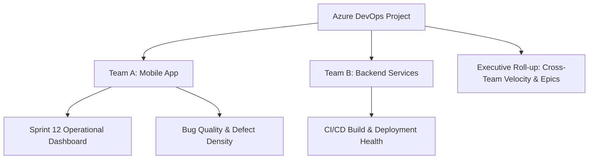
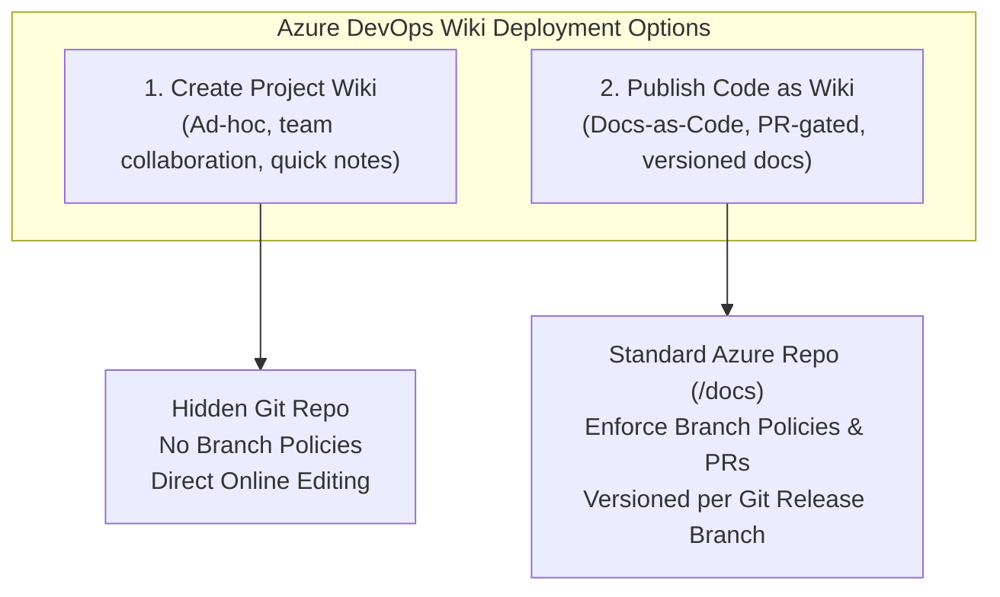

# Module 04: Collaboration & Communication

> **Course:** AZ-400 — Designing and Implementing Microsoft DevOps Solutions  
> **Instructor:** Andrew Brown (ExamPro)  
> ⬅️ [Previous: 03. Azure Boards Deep Dive](03-azure-boards-deep-dive.md) | [Main Index](../README.md) | ➡️ [Next: 05. GitHub Fundamentals & Architecture](05-github-fundamentals.md)

---

## 📑 Module Overview

- [Custom Azure Boards Dashboards](#custom-azure-boards-dashboards)
- [Wikis for Documentation](#wikis-for-documentation) *(Coming next)*
- [Process Diagrams for Documentation](#process-diagrams-for-documentation) *(Coming next)*
- [Configure Release Documentation](#configure-release-documentation) *(Coming next)*
- [API Documentation](#api-documentation) *(Coming next)*
- [Automate Git History Documentation](#automate-git-history-documentation) *(Coming next)*
- [What are Webhooks](#what-are-webhooks) *(Coming next)*
- [Configure Notifications with Webhooks](#configure-notifications-with-webhooks) *(Coming next)*

---

### Custom Azure Boards Dashboards

#### 1. Slide Transcripts (As-Is)

##### Part 1: Overview, Widgets & Query Widgets
> **Custom Azure Boards dashboards**  
> *Cheat sheets, Practice Exams and Flash cards 👉 www.exampro.co/az-400*
>
> **Centralize with Custom Dashboards**  
> **Custom dashboards in Azure Boards** are crucial for presenting a comprehensive **overview of your project's status and key metrics**.
> - By tailoring these dashboards to highlight crucial data, your team can streamline workflows and improve decision-making.
>
> **Customize with Widgets**  
> **Widgets** are the heart of Azure Boards dashboards, presenting diverse data from **progress charts to work item queries**. Select and tailor widgets that best display the team's critical information, ensuring essential insights are readily accessible.
>
> **Monitor Backlogs with Query Widgets**  
> Incorporate **query widgets** to **filter and display work items based on defined criteria**, like outstanding tasks per team member.  
> This enables efficient task management and helps in setting clear priorities.
>
> *(UI Callouts: Overview -> Dashboards in navigation; Add Widget dialog showing 'Velocity' by Microsoft; 'Query Results' widget displaying results from a query; 'Query Tile' widget displaying total number of results for a query).*

##### Part 2: Burndown, Performance Charts & Team Engagement
> **Custom Azure Boards dashboards**  
> *Cheat sheets, Practice Exams and Flash cards 👉 www.exampro.co/az-400*
>
> **Track Progress with Burndown Charts**  
> Use **burndown chart** widgets to graphically **track project progress**, helping to identify any delays. Regular review of these charts keeps the team's progress aligned with project goals.
>
> **Visualize Performance with Charts**  
> Enrich your dashboard with charts that **convey performance metrics**, such as **bug trends or team velocity**, providing a clear picture of the team's dynamics and highlighting areas for improvement.
>
> **Enhance Team Engagement**  
> Share dashboards with your **team and stakeholders** to offer a **live view of the project's status**, fostering a culture of transparency and collective accountability.
>
> *(UI Callouts: 'Burndown' widget displaying burndown across multiple teams and sprints; 'Chart for Build History' widget showing build history of a selected build definition; Example Dashboard showing tiles for Completed Work [50], Active Work [10], Planned Work [76], Unplanned Work [27], Work Moved Out [34], Backlog and tags [220], Team Velocity bar charts, and Sprint Burndown area chart).*

---

#### 2. Visual References


---

#### 3. Expert-Level Deep Dive & Practical Notes

- **Dashboard Architecture: Team vs Project Dashboards**:
  - In Azure DevOps, dashboards can be configured at two levels:
    1. **Team Dashboards**: Owned by a specific team (e.g., *Frontend Team*, *Core API Team*). Each team can have multiple dashboards.
    2. **Project Dashboards**: Visible to everyone across all teams in the project, ideal for executive roll-up views and cross-team alignment.
  - Dashboards are accessed via **Overview -> Dashboards** in the left sidebar navigation.



---

- **Core Widget Taxonomy & Capabilities**:

  | Category | Key Widgets | Purpose & What It Measures |
  | :--- | :--- | :--- |
  | **Work Item Tracking** | **Query Tile** | Single large metric showing count of matching work items (e.g., *Active P1 Bugs: 4*). Supports conditional color rules. |
  | | **Query Results** | Paginated tabular list of work items from a shared query with sortable columns. |
  | | **Assigned to Me** | Filtered personal view for the logged-in user. |
  | **Flow & Agile Metrics** | **Velocity** | Compares planned work vs. delivered work in Story Points/Effort across previous sprints. |
  | | **Burndown / Burnup** | Remaining work hours or work item count versus ideal trend line over time. |
  | | **Cumulative Flow Diagram (CFD)** | Work in Progress (WIP), Cycle Time, and bottleneck identification across Kanban columns. |
  | | **Lead Time & Cycle Time** | Time elapsed from creation/active state to completion. |
  | **Build & Pipeline Health** | **Build History** | Visual bar chart of recent runs (success/failure) for a specific CI/CD pipeline. |
  | | **Deployment Status** | Tracks stage-by-stage deployment across environments (Dev -> QA -> Prod). |
  | **Extensibility & Analytics** | **Markdown / Embedded Webpage** | Custom instructions, team mission, external runbooks, or PowerBI reports. |

---

- **Configuring Query-Based Widgets (Step-by-Step)**:
  1. **Step 1: Create a Shared Query**:
     - Navigate to **Boards -> Queries -> + New query**.
     - Specify query criteria, e.g.:
       - `Work Item Type = Bug`
       - `State = Active`
       - `Priority <= 2`
     - Save query under **Shared Queries** (Widgets *cannot* read queries saved under *My Queries* when shared with team members).
  2. **Step 2: Add Widget to Dashboard**:
     - Go to **Overview -> Dashboards**.
     - Click **Edit** (pencil icon at top right) -> search for **Query Tile** or **Chart for Work Items** -> click **Add**.
  3. **Step 3: Configure Widget Properties**:
     - Click the widget gear icon -> select the Shared Query created in Step 1.
     - For **Query Tile**: Define color thresholds (e.g., turn green if count is 0, yellow if 1-3, red if >= 4).
     - For **Chart for Work Items**: Select chart type (Pie, Bar, Pivot table), grouping field (e.g., `Assigned To`), and value (`Count of Work Items`).

---

- **Executive & Stakeholder Dashboards (AZ-400 Best Practice)**:
  - Non-developers (managers, clients, stakeholders) holding free **Stakeholder Access** licenses can view dashboards and interact with charts.
  - Best practice dashboard layout:
    - **Top Row**: High-level status tiles (Active Blockers, Sprint Days Remaining, Critical Vulnerabilities).
    - **Middle Row**: Progress & flow widgets (Sprint Burndown, Team Velocity).
    - **Bottom Row**: Deployment & quality status (Build History, Code Quality / SonarQube scorecards).

> [!TIP]
> **AZ-400 Exam Tip**:
> - For a dashboard widget to display work items to other team members, the underlying query **MUST be saved in the `Shared Queries` folder**, not `My Queries`. If saved in `My Queries`, other users will see an access error on the dashboard.
> - **Stakeholder** license holders can view dashboards, run shared queries, and view charts at no additional licensing cost.

---

### Wikis for Documentation

#### 1. Slide Transcripts (As-Is)

##### Part 1: Overview & Project Requirements
> **Wiki for Documentation**  
> *Cheat sheets, Practice Exams and Flash cards 👉 www.exampro.co/az-400*
>
> **Wiki offers a collaborative space for team members to compile and share crucial details about a DevOps project.**
>
> **Start with an Overview Page:**  
> Begin by setting up an **overview page**. This should introduce the **project, its goals, and the team working** on it.  
> Mention the **technologies, tools, and methods your project** employs, keeping it broad but informative.
>
> *(UI Callout: Example 'Project Overview' containing Welcome message, Team Members list [Alex Johnson - Project Manager, Jamie Doe - Lead Developer, Chris Smith - QA Engineer, Jordan Lee - UI/UX Designer], and Technologies & Tools [Frontend: React.js/Redux, Backend: Node.js/Express, Database: MongoDB, CI/CD: Jenkins/Azure Pipelines, Version Control: Git/Azure Repos]).*
>
> **Detail Project Requirements:**  
> Dedicate pages to outline the **project's requirements**.  
> Break down what the project **needs to do (functional requirements)** and how it should perform **(non-functional requirements)**, using clear and achievable language.  
> Add **user stories**, what needs to be true for the project to be considered complete **(acceptance criteria)**, and any other elements that rely on each other **(dependencies)**.
>
> *(UI Callout: Example 'Project Requirements' containing Functional Requirements [create account, edit profile], Non-Functional Requirements [load within 3 seconds, data protection compliance], User Stories, Acceptance Criteria, and Dependencies).*

##### Part 2: Architecture & Collaborative Input
> **Wiki for Documentation**  
> *Cheat sheets, Practice Exams and Flash cards 👉 www.exampro.co/az-400*
>
> **Architecture and Design Documentation:**  
> Use the wiki to detail the **project's structure and design**. Make a separate page for each part, whether it's **a component, a larger section, or a service**.  
> To help visualize how these parts interact, include diagrams like **UML (Unified Modeling Language)** or system architecture sketches.
>
> *(UI Callout: Example 'Architecture and Design' containing Overview of microservices architecture, User Service breakdown [responsibilities, Node.js/JWT], Email Service breakdown [SendGrid, Azure Functions]).*
>
> **Encourage Team Input:**  
> Get your team involved in the documentation process.  
> Allowing everyone to **edit and update wiki pages** not only promotes teamwork but also helps keep the information **current**.  
> Make sure to use the wiki's version tracking to monitor changes and roll back if needed.
>
> *(UI Callout: Example 'Collaborative Content Creation' covering editing instructions, commit messages, and Version Tracking to view change history and revert).*

##### Part 3: Live Markdown Editor Interface
> **Azure DevOps Services Portal — Wiki Editor Walkthrough**  
> **Path**: `Overview -> Wiki -> Example Wiki Markdown` (`dev.azure.com/exampro1/examprotest`)  
> - **Dual-Pane View**: Split editor with Raw Markdown on the left and Live Rendered HTML Preview on the right.  
> - **Formatting Toolbar**: Bold, Italics, Strikethrough, Headings (H1/H2/H3), Bulleted/Numbered Lists, Checklists, Blockquotes, Code blocks, Tables, Links, and Image uploads.  
> - **Version Tracking & Actions**: Page revisions, Clone wiki, Print, and Link to work items.

---

#### 2. Visual References


---

#### 3. Expert-Level Deep Dive & Practical Notes

- **Project Wiki vs. Publish Code as Wiki (AZ-400 Core Knowledge)**:
  - In Azure DevOps, there are **two distinct types** of Wikis. Understanding the architectural differences between them is one of the most frequently tested concepts on the AZ-400 exam:

  | Architectural Capability | **Project Wiki** (Built-in Provisioned Wiki) | **Publish Code as Wiki** (Git Repository Wiki) |
  | :--- | :--- | :--- |
  | **Storage Mechanism** | Hidden backend Git repo managed internally by Azure DevOps | Standard Git repository (or subfolder, e.g. `/docs`) inside Azure Repos |
  | **Branch Policies & PR Workflow** | ❌ No PRs; changes committed directly to main wiki branch | ✅ Full PR support, branch protection, peer code review policies |
  | **Multi-Version / Branching Documentation** | ❌ Single version only | ✅ Multi-version (publish separate docs per release branch e.g. `v1.0`, `v2.0`) |
  | **Local IDE Offline Editing** | Cloned via special hidden Git URL | Standard Git clone (`git clone`) with VS Code / Markdown editors |
  | **Max Page Limit & Hierarchy** | Up to 1 GB repo size; sub-pages reordered via drag-and-drop | Defined by folder structure and `.order` metadata files |
  | **Auditing & History** | Revision history visible in portal | Full `git log`, blame, and commit SHAs |



---

- **Publishing Code as Wiki (Docs-as-Code Workflow)**:
  1. Store markdown documentation directly in your application codebase under a `/docs` directory.
  2. In Azure DevOps, navigate to **Overview $\rightarrow$ Wiki**.
  3. Click the dropdown next to the wiki name $\rightarrow$ select **Publish code as wiki**.
  4. Select the **Repository**, the target **Branch** (e.g. `main`), and the **Folder** (`/docs`).
  5. Provide a Wiki name $\rightarrow$ click **Publish**.
  6. *Benefit*: Developers update documentation in the same Pull Request that modifies source code, ensuring docs never drift out of sync with code releases.

---

- **Ordering Pages via `.order` Files**:
  - In a Code Wiki, pages are ordered alphabetically by default.
  - To specify custom ordering, create a text file named `.order` inside the folder and list the file names (without `.md` extension) in desired display order:
    ```
    Project-Overview
    Architecture-and-Design
    API-Contracts
    Deployment-Guide
    ```

---

- **Advanced Markdown Features in Azure DevOps Wiki**:
  - **Work Item Referencing**: Typing `#<ID>` (e.g., `#105`) embeds a live interactive chip showing the work item title, type, and current state.
  - **Mentioning Users**: Typing `@<User>` sends an automated notification to that team member.
  - **Mermaid Diagrams**: Native rendering inside fenced code blocks:
    ````markdown
    ```mermaid
    sequenceDiagram
        Client->>AuthService: POST /oauth/token
        AuthService-->>Client: JWT Bearer Token
    ```
    ````
  - **Table of Contents Generation**: Adding `[[_TOC_]]` at the top of a page automatically builds an interactive TOC based on markdown headings.
  - **Active Work Item Query Results**: Embed dynamic query results using the query syntax:
    ```markdown
    ::: query-table <Query-GUID>
    :::
    ```

> [!TIP]
> **AZ-400 Exam Tip**:
> - If an exam scenario requires **peer review, branch policies, or versioning documentation alongside release branches (e.g. v1 vs v2 docs)**, the correct answer is always **"Publish code as wiki"** pointing to an Azure Repos Git branch.
> - To enforce custom page order in a published code wiki, use a **`.order`** file.
> - `[[_TOC_]]` generates a table of contents automatically.

### Process Diagrams for Documentation
*Awaiting slide content / screenshot...*

### Configure Release Documentation
*Awaiting slide content / screenshot...*

### API Documentation
*Awaiting slide content / screenshot...*

### Automate Git History Documentation
*Awaiting slide content / screenshot...*

### What are Webhooks
*Awaiting slide content / screenshot...*

### Configure Notifications with Webhooks
*Awaiting slide content / screenshot...*
